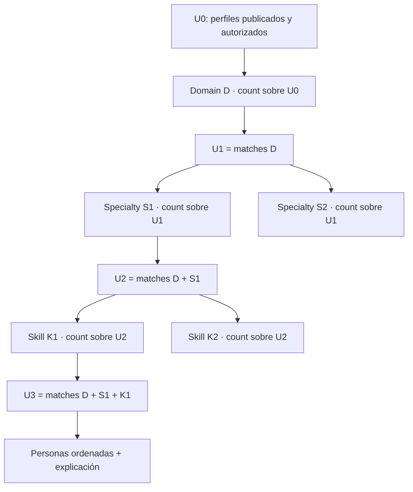

# FASE 1 — Auditoría read-only del buscador progresivo de personas por competencias MC1

**Estado:** `AUDIT_COMPLETE_WITH_BLOCKERS`  
**Fecha de corte:** 2026-08-12 (`America/Bogota`)  
**Backend auditado:** `feat/mc1-competencies-mvp` @ `ff63960`, incluyendo el working tree local existente  
**Frontend auditado:** `feat/mc1-competencies-mvp` @ `ccc8b67`, incluyendo el working tree local existente

## Alcance, método y límites de evidencia

La auditoría contrastó código, contratos, migraciones, configuración, documentación, tests y datos Cloud accesibles mediante la configuración ya existente. Las consultas a PostgreSQL se ejecutaron únicamente como `SELECT`, con `default_transaction_read_only=on` y una transacción explícita `BEGIN READ ONLY`; no se expuso PII en este documento. No se ejecutaron pipelines MC1, importadores, publishers, migraciones, smoke scripts, deploys ni comandos capaces de mutar Cloud. Los tests fueron inspeccionados estáticamente y no ejecutados, para respetar la regla de que este documento sea la única escritura de la fase y evitar caches o artefactos del runner.

Los repositorios ya contenían cambios modificados y archivos no rastreados antes de esta auditoría. Se preservaron. Este documento describe el sistema ejecutable observado en ese working tree, no solo el último commit.

## 1. Executive Summary

La funcionalidad es viable sin volver a ejecutar MC1. La fuente segura y más corta hacia la verdad publicada es `organigrama.mc1_person_profile_presentation`: contiene 128 filas activas, todas con `status=AVAILABLE` y `source=CLOUD_PRESENTATION_STORE`, para 128 personas activas. El backend ya la prioriza al construir la pestaña Competencias de `PersonDetailPanel`.

El Explorer transversal `/org/competency-explorer` sí existe, pero su ruta de datos es 100% mock: estadísticas, catálogo, personas, conteos ilustrativos, evidencia y ranking se calculan en el navegador sobre 14 perfiles ficticios. Su shell visual, estado progresivo, selección múltiple, búsqueda directa y semántica `USER`/`CONTEXT` son aprovechables; sus datos, taxonomía, porcentaje y `evidenceStrength` no lo son.

La arquitectura mínima recomendada es:

```text
presentaciones MC1 activas y validadas
          + catálogo runtime actual
          + personas activas
          + universo autorizado del viewer
                       ↓
        servicio backend de búsqueda facetada
                       ↓
  resultados paginados + facets/counts + explicación
                       ↓
       Explorer React adaptado + PersonDetailPanel
```

No hace falta una materialización, Elasticsearch, vector DB, LLM ni microservicio en V1. El conjunto completo de payloads activos ocupa aproximadamente 283 KiB de JSON textual (promedio 2.212 bytes por perfil), por lo que una lectura/expansión determinística en backend es suficiente al volumen actual.

Los bloqueos previos a implementación son decisiones de producto/seguridad y de contrato: definir quién puede descubrir competencias y cómo se protegen los conteos; decidir semántica multi-selección/facets; y fijar una política explícita para identidad de skills. En producción hay 484 códigos de skill para solo 573 ocurrencias: 440 códigos aparecen en una sola persona, 43 códigos tienen más de un label y un código aparece bajo dos specialties. Además, el payload publicado no conserva versión de catálogo/perfil, status `OBSERVED`/`WEAK` ni provenance de skill.

## 2. Current Architecture Map

```mermaid
flowchart TD
  CV[(organigrama.person_cv)] --> P0[P0 Snapshot]
  P0 --> P1[P1 Evidence Units]
  P1 --> P2[P2 Field Candidates]
  P2 --> R1[R1 Field Resolution]
  R1 --> P3[P3 Specialties]
  P3 --> P4[P4 Skills]
  CAT[JSON runtime catalogs\nFields 2.0.0 + Specialties 1.12.0] --> R1
  CAT --> P3
  CAT --> P4
  P4 --> ASSEMBLY[Profile Assembly\nMC1.PROFILE.PILOT 1.0.0]
  R1 --> ASSEMBLY
  P3 --> ASSEMBLY
  ASSEMBLY --> GATE[Field Publication Gate\nPUBLISHABLE / PROVENANCE_ONLY]
  GATE --> BATCH[Operational batch selection\nSAFE / HOLD local]
  BATCH --> STORE[(organigrama.mc1_person_profile_presentation\nactive JSONB)]
  STORE --> READER[readMc1PersonProfile\nCloud first]
  LOCAL[tmp profile packs\nnon-production fallback] --> READER
  READER --> API[GET professional-profile]
  API --> PDP[PersonDetailPanel\nCompetenciasExplorer]

  LEGACY[(PA2 normalized legacy tables)] --> LEGACYAPI[Legacy person competency APIs]
  LEGACYAPI --> FALLBACK[Person profile fallback]
  FALLBACK --> PDP

  ROUTE[/org/competency-explorer] --> MOCKS[Mock catalog + 14 mock people]
  MOCKS --> CLIENTRANK[Client-side rankPeople]
  CLIENTRANK --> CARDS[Mock result cards]
```

Flujo de request productivo para el perfil MC1 actual:

```text
GET /api/org-chart/person/:personId/competencies/professional-profile
  → JwtAuthGuard global
  → OrgChartController
  → OrgChartCompetenciesService.assertCanView
  → OrgChartVisibilityService.canViewFullProfile
  → readMc1PersonProfile
  → active Cloud presentation store
  → validateMc1PresentationPayload
  → CompetencyProfessionalProfileDto.mc1Profile
  → CompetenciesExplorer
  → Mc1PersonCompetenciesView
```

## 3. MC1 Published Data Source

La fuente real del perfil MC1 publicable que consume producto es la fila activa de `organigrama.mc1_person_profile_presentation`. El reader intenta Cloud primero y solo permite fallback a artefactos `tmp/` fuera de producción o mediante override explícito. En producción, un error de lectura Cloud devuelve `INVALID`; no cae a datos locales.

El conjunto seguro base, antes de autorización, es:

```text
SEARCHABLE_BASE =
  active presentation row
  ∩ payload accepted by presentation validator
  ∩ payload.status = AVAILABLE
  ∩ active core.person
```

El conjunto que una request puede ver debe ser menor o igual:

```text
SEARCHABLE_MC1_PERSONS(viewer, orgVersion) =
  SEARCHABLE_BASE
  ∩ competency visibility policy(viewer, orgVersion)
```

No deben usarse perfiles locales, batches `HOLD`, tablas P3/P4 experimentales ni evaluaciones PA2 legacy como sustituto silencioso del store publicado.

## 4. Catalog Source of Truth

Hay dos catálogos runtime nuevos y una familia legacy diferente:

1. Fields: `src/mc-pipeline/catalog/mc1-professional-fields-v2.json`, cargado por `professional-fields.ts`.
2. Specialties: doce JSON `mc1-specialties-*-v1.json`, unificados por `specialties-visual-education.ts`.
3. Skills: no existe catálogo cerrado de skills MC1 nuevo. P4 genera skills por perfil y el payload publicado las anida en su specialty de origen.
4. Las tablas `mc_catalog_version`, `mc_domain`, `mc_specialty` y `mc_skill_specialty_mapping` pertenecen al modelo PA2 anterior. No son la fuente runtime del Profile Assembly nuevo.

Los aliases presentes son aliases legacy de field y specialty. No existe un registro canónico/alias global para los skills dinámicos publicados. `cv_skill_alias` también pertenece a la extracción/PA2 legacy y no resuelve automáticamente los skills P4 nuevos.

## 5. Current Catalog Version

`CURRENT_CATALOG_VERSION` no puede representarse honestamente con un único escalar. El estado ejecutable es esta tupla:

| Parte | Código | Versión | Estado |
| --- | --- | --- | --- |
| Professional fields | `MC1.PROFESSIONAL_FIELD_CATALOG` | `2.0.0` | `FROZEN` |
| Unified specialties | `MC1.SPECIALTY_CATALOG` | `1.12.0` | `ACTIVE` |
| Profile contract procesado | `MC1.PROFILE.PILOT` | `1.0.0` | experimental/artifact contract |
| Field publication gate | `MC1.PROFILE.PUBLICATION_GATE.1.0.0` | `1.0.0` implícito | runtime |
| Radar formula | `8E.EXPERIMENTAL.1` | experimental | runtime |
| Dimension registry | runtime constant | `8C.10` | runtime |

`1.12.0` sí es vigente, pero únicamente como fingerprint lógico del catálogo unificado de specialties. Los doce archivos fuente internos son `1.0.0 ACTIVE`, salvo Visual/Education `1.1.0 FROZEN`.

El payload publicado no incluye `catalogVersion`, `profileVersion`, `contractCode` ni `contractVersion`. La tabla guarda `config_fingerprint`, pero ese valor identifica configuración de ensamblaje, no una versión de catálogo. Conviven 15 fingerprints entre las 128 filas activas; uno incluso es el label `software-cohort-9e`, no un hash. Por tanto, no se puede demostrar desde el store que todos los payloads se produjeron con exactamente la misma tupla de catálogo.

La base legacy contiene 12 versiones `mc1-domains`; solo `mc1.17-education-alex-2026-07-30` está activa. Ese versionamiento no debe confundirse con Fields `2.0.0` / Specialties `1.12.0` del pipeline nuevo.

## 6. Domain Model

El modelo runtime de field/domain es `{ code, name, definition }`. El status y la versión viven en el wrapper de catálogo. No hay `sort` explícito: el orden efectivo es el orden del array JSON.

Hay 14 fields:

```text
VISUAL_DESIGN
EDUCATION
AUDIOVISUAL_PRODUCTION
SOFTWARE_ENGINEERING
DATA_ANALYTICS
IT_SYSTEMS
DIGITAL_MARKETING
COMMUNICATIONS
ACADEMIC_RESEARCH
PROJECT_PROGRAM_MGMT
PEOPLE_HR
FINANCE_ADMIN
CUSTOMER_SUCCESS
LEGAL
```

En producción aparecen 13; `ACADEMIC_RESEARCH` no aparece en las presentaciones activas.

En el perfil procesado el campo se llama `fieldCode`, con `role`, `r1Confidence`, children, radar, evidencia y publicación. En presentación se reduce a `code`, `label`, `role`, `confidence?`, children, tools, competency map y `evidenceVolume`.

## 7. Specialty Model

Cada specialty runtime tiene:

```ts
{
  code: string
  name: string
  parentField: string
  definition: string
  positiveSignals: string[]
  exclusions: string[]
}
```

Hay 53 specialties únicas, sin códigos duplicados, cubriendo 13 de 14 fields. `ACADEMIC_RESEARCH` no tiene catálogo de specialties. La relación specialty → field es determinística en código.

Inventario completo por field:

```text
AUDIOVISUAL_PRODUCTION (4)
  ├─ VIDEO_PRODUCTION
  ├─ VIDEO_POST_PRODUCTION
  ├─ PHOTOGRAPHY
  └─ AUDIO_PRODUCTION
COMMUNICATIONS (4)
  ├─ CORPORATE_COMMUNICATIONS
  ├─ DIGITAL_COMMUNICATIONS
  ├─ PUBLIC_RELATIONS
  └─ JOURNALISM
CUSTOMER_SUCCESS (4)
  ├─ CUSTOMER_INTAKE_ONBOARDING
  ├─ CUSTOMER_LIFECYCLE_CARE
  ├─ CUSTOMER_RETENTION_LOYALTY
  └─ CUSTOMER_SERVICE_SUPPORT
DATA_ANALYTICS (4)
  ├─ BUSINESS_INTELLIGENCE
  ├─ DATA_ENGINEERING
  ├─ PREDICTIVE_ANALYTICS
  └─ DATA_GOVERNANCE
DIGITAL_MARKETING (4)
  ├─ CAMPAIGN_MARKETING
  ├─ GROWTH_MARKETING
  ├─ PRODUCT_MARKETING
  └─ BRAND_DIGITAL_MARKETING
EDUCATION (4)
  ├─ TEACHING_FACILITATION
  ├─ INSTRUCTIONAL_DESIGN
  ├─ CURRICULUM_DESIGN
  └─ ACADEMIC_MANAGEMENT
FINANCE_ADMIN (4)
  ├─ FINANCIAL_MANAGEMENT
  ├─ BUDGET_FINANCIAL_CONTROL
  ├─ ACCOUNTING_OPERATIONS
  └─ ADMINISTRATIVE_MANAGEMENT
IT_SYSTEMS (4)
  ├─ NETWORK_INFRASTRUCTURE
  ├─ IT_SERVICE_DESK
  ├─ SYSTEMS_ADMINISTRATION
  └─ IT_SECURITY_OPERATIONS
LEGAL (5)
  ├─ LEGAL_ADVISORY
  ├─ LEGAL_DOCUMENT_DRAFTING
  ├─ PUBLIC_SECTOR_CONTRACTING
  ├─ ADMINISTRATIVE_LAW
  └─ LITIGATION_DISPUTES
PEOPLE_HR (2)
  ├─ TALENT_ACQUISITION
  └─ WORKFORCE_ADMINISTRATION
PROJECT_PROGRAM_MGMT (4)
  ├─ PROJECT_MANAGEMENT
  ├─ PROGRAM_MANAGEMENT
  ├─ PMO_GOVERNANCE
  └─ PROCESS_IMPROVEMENT
SOFTWARE_ENGINEERING (4)
  ├─ FRONTEND_ENGINEERING
  ├─ BACKEND_ENGINEERING
  ├─ MOBILE_ENGINEERING
  └─ PLATFORM_DEVOPS_ENGINEERING
VISUAL_DESIGN (6)
  ├─ GRAPHIC_DESIGN
  ├─ UX_PRODUCT_DESIGN
  ├─ BRAND_IDENTITY_DESIGN
  ├─ EDITORIAL_DESIGN
  ├─ ILLUSTRATION
  └─ MOTION_DESIGN
ACADEMIC_RESEARCH (0)
```

En las 128 presentaciones aparecen 45 specialties. Las ocho sin ocurrencias son `PUBLIC_RELATIONS`, `JOURNALISM`, `DATA_GOVERNANCE`, `PMO_GOVERNANCE`, `MOBILE_ENGINEERING`, `EDITORIAL_DESIGN`, `ILLUSTRATION` y `MOTION_DESIGN`.

## 8. Skill Model

P4 representa una skill como `{ skillCode, name, parentFieldCode, parentSpecialtyCode, status, confidence, support, rationale }`. El normalizador fuerza el parent al field/specialty que se está evaluando, elimina genéricos y tools, normaliza el code como slug y rebaja `OBSERVED` con soporte insuficiente a `WEAK`.

No existe un catálogo activo cerrado de skills. Los JSON de specialties contienen 49 ocurrencias `reservedFutureSkills` (47 códigos únicos; `MARKETING_MIX_MODELING` y `BUDGET_TRACKING` se repiten), pero son conceptos reservados, no el universo publicable.

En producción hay:

| Métrica | Valor |
| --- | ---: |
| Ocurrencias de skill | 573 |
| Códigos únicos | 484 |
| Códigos presentes en una sola persona | 440 |
| Códigos presentes en dos personas | 29 |
| Máxima reutilización de un código | 10 personas |
| Códigos con más de un label | 43 |
| Códigos con más de una specialty padre | 1 |

El caso multi-parent es `learning_assessment_design`, bajo `CURRICULUM_DESIGN` e `INSTRUCTIONAL_DESIGN`, siempre en `EDUCATION`, en dos perfiles. `document_management` tiene diez labels distintos para diez personas. Esto impide asumir `skillCode → una specialty` globalmente. Sí es determinística la relación por ocurrencia porque la skill está físicamente anidada bajo una specialty en el payload.

Recomendación de contrato V1: indexar la ocurrencia exacta `(fieldCode, specialtyCode, skillCode)` y modelar `skillCode → contexts[]`; no fusionar silenciosamente por label. Una normalización/alias futura debe ser explícita, auditable y externa a la consulta.

## 9. mc1Profile Contract

El contrato procesado `ProfilePilotEnvelope` conserva:

- `contractCode`, `contractVersion`, `stageCode`, `producedAt`, warnings.
- `snapshotId`, status R1 y todos los fields publicables.
- `resolvedFieldsProvenance`, incluyendo fields `PROVENANCE_ONLY`.
- role y confidence R1.
- specialties observadas con confidence.
- skills observadas con confidence, parent, IDs de evidencia y support.
- tools separadas.
- mappings skill → dimensiones con justificación y evidencia.
- radar con raw score, cobertura relativa, skills y evidencia contribuyente.
- volumen y conteo de evidencia.
- publication status, reason y taxonomy pending.
- rutas de packs/provenance local.

El contrato publicado `Mc1PersonCompetenciesPresentationDto` conserva únicamente:

```ts
{
  status: 'AVAILABLE'
  source: 'ARTIFACT_ONLY_LOCAL' | 'CLOUD_PRESENTATION_STORE'
  fields: [{
    code, label,
    role: 'PRIMARY' | 'SECONDARY',
    confidence?, derivedPresentationLabel?,
    specialties: [{ code, label, confidence?, skills: [{ code, name }] }],
    tools: string[],
    competencyMap: { dimensions: [{ code, label, relativeCoverage }] },
    evidenceVolume: 'LOW' | 'MEDIUM' | 'HIGH'
  }]
}
```

Se eliminan versionamiento, status P3/P4, publication decision, taxonomy pending, support/provenance de skill, evidence IDs/count, raw radar score, timestamps y fingerprints. La tabla conserva fingerprint/timestamps por fuera del JSON, pero el reader no los entrega al frontend.

## 10. Primary Domain Representation

Primary es un field block con `role='PRIMARY'`, no una propiedad `primaryDomainCode`. Proviene de R1 y conserva `r1Confidence` en el perfil procesado; la presentación lo expone como `confidence`. Tiene el mismo modelo de specialties, skills, tools, radar y evidencia que secondary.

El Publication Gate siempre permite el primary. Si no existe catálogo de specialty, lo marca `PRIMARY_TAXONOMY_PENDING`; si existe pero no hay specialty observada puede quedar `PRIMARY_RESOLVED`. Un batch operacional posterior puede retener un primary vacío, de modo que “publishable por gate” y “safe to import” no son idénticos.

En Cloud hay 127 fields primary para 128 perfiles: 127 perfiles tienen exactamente uno y uno no tiene ninguno. El payload anómalo sigue siendo aceptado por el validator actual porque este valida el enum de cada role, pero no exige cardinalidad primary.

## 11. Secondary Domain Representation

Puede haber 0..N secondaries. En el corte real:

- 59 perfiles no tienen secondary.
- 69 tienen al menos uno.
- el máximo es tres.
- hay 78 ocurrencias secondary.

Secondary usa el mismo bloque y puede publicar specialties, skills, tools y radar. Se publica únicamente si el field tiene catálogo y al menos una specialty P3 `OBSERVED`; si no, queda en provenance procesada pero no en la presentación.

Por tanto, primary y secondary pueden hacer matching uniforme por code, specialty y skill. `role` permite explicar y eventualmente desempatar sin excluir secondary. No debe asumirse que secondary es evidencia débil: el role expresa resolución/clasificación del field, no ausencia de evidencia en sus children.

## 12. OBSERVED / WEAK Representation

`P3SpecialtyStatus = OBSERVED | WEAK | REJECTED`. P4 también usa `OBSERVED | WEAK`. La secuencia real es:

```text
P3 artifact: OBSERVED / WEAK / REJECTED
  → Profile loader: solo P3 OBSERVED
P4 artifact: OBSERVED / WEAK
  → Profile loader: solo P4 OBSERVED cuyo parent P3 también es OBSERVED
  → Profile Assembly / radar
  → presentation DTO sin campo status
```

Respuestas exactas:

- ¿Puede un mc1Profile procesado contener P3 `WEAK` en su artefacto fuente? Sí.
- ¿Puede la presentación normal publicada contener specialty `WEAK`? No por el assembler actual.
- ¿Puede publicar skills colocadas bajo una specialty P3 `WEAK`? No; permanecen en P4 artifact y se excluyen de skills públicas y radar.
- ¿El frontend oculta `WEAK`? No aplica un filtro propio en la vista MC1 nueva; el status ya fue eliminado antes.
- ¿Puede demostrarse `OBSERVED` desde el payload? No explícitamente; solo se infiere por el proceso de gate/assembly vigente.

En Cloud hay cero marcadores textuales `OBSERVED` y cero `WEAK` en las 128 filas, coherente con el DTO reducido.

## 13. Publication Gate

El gate de field tiene dos estados reales:

| Role/caso | Estado | Reason | Taxonomy pending |
| --- | --- | --- | --- |
| Primary con catálogo y specialty observada | `PUBLISHABLE` | `PRIMARY_WITH_OBSERVED_SPECIALTY` | false |
| Primary con catálogo sin specialty | `PUBLISHABLE` | `PRIMARY_RESOLVED` | false |
| Primary sin catálogo | `PUBLISHABLE` | `PRIMARY_TAXONOMY_PENDING` | true |
| Secondary sin catálogo | `PROVENANCE_ONLY` | `SECONDARY_TAXONOMY_NOT_AVAILABLE` | true |
| Secondary con catálogo sin observed specialty | `PROVENANCE_ONLY` | `SECONDARY_NO_OBSERVED_SPECIALTY` | false |
| Secondary con observed specialty | `PUBLISHABLE` | `SECONDARY_WITH_OBSERVED_SPECIALTY` | false |

`selectPublishableFields` elimina `PROVENANCE_ONLY` antes de la presentación. Los tests verifican explícitamente primary/secondary y la eliminación de tabs secondary vacíos.

No existe un gate independiente por skill en el DTO publicado: la elegibilidad resulta de los filtros P3/P4 del profile loader y del parent observed.

## 14. Taxonomy Pending / Held States

`taxonomyPending`, `PRIMARY_TAXONOMY_PENDING` y las decisiones `PROVENANCE_ONLY` viven en el perfil procesado, no en el store de presentación.

`HOLD_FOR_TAXONOMY:*`, `SAFE_TO_IMPORT`, `WEAK_SPECIALTY_PUBLIC`, `EMPTY_PRIMARY_TAB` y `NO_PUBLISHABLE_FIELDS` aparecen en scripts locales de preparación de batches. No son columnas ni estados persistidos en `mc1_person_profile_presentation`.

Consecuencias:

- Cloud puede contar filas activas publicadas, pero no perfiles held o taxonomy pending que nunca se importaron.
- El store tampoco diferencia `APPROVED`, `PUBLISHED` y `ACTIVE`; la presencia de una fila activa es la única señal operacional.
- Los conteos de held/taxonomy pending actuales no son recuperables de Cloud con certeza.
- Cero payloads activos contienen texto `taxonomy` o `held`, pero esto no prueba que no existan artefactos locales retenidos.

## 15. Presentation Store

Nombre real: `organigrama.mc1_person_profile_presentation`.

| Columna | Tipo | Semántica |
| --- | --- | --- |
| `id` | `BIGSERIAL` PK | Identidad de fila |
| `person_id` | `BIGINT` FK | `core.person(id)`, `ON DELETE RESTRICT` |
| `payload_json` | `JSONB` | DTO gateado de presentación |
| `config_fingerprint` | `TEXT` | Config de ensamblaje, no catalog version |
| `produced_at` | `TIMESTAMPTZ` | Producción del perfil |
| `is_active` | `BOOLEAN` | Una fila activa por persona |
| `imported_at` | `TIMESTAMPTZ` | Importación al store |

Índices: PK; unique parcial `person_id WHERE is_active`; B-tree `(person_id,is_active)`; B-tree `config_fingerprint`. No hay GIN sobre JSONB ni índice por field/specialty/skill.

Lectura: `readActiveMc1PresentationFromStore` por person ID. Escritura: `mc1-person-profile-importer.ts` valida, abre transacción, desactiva la fila anterior e inserta una nueva; no es un upsert in-place. El importer verifica existencia de persona, pero no que esté activa. Los 128 registros actuales sí corresponden a personas activas.

## 16. Current Production Data Availability

Corte read-only de Cloud:

| Concepto | Conteo | Nota |
| --- | ---: | --- |
| Personas totales | 1.629 | `core.person` |
| Personas activas | 1.620 | universo organizacional |
| Filas `person_cv` | 250 | histórico incluido |
| CV activos | 186 | 186 personas; 183 siguen activas |
| Personas con alguna extracción | 139 | 245 filas |
| Extracción activa `SUCCEEDED` | 139 | 138 personas siguen activas |
| Evaluaciones PA2 legacy | 83 | 34 personas |
| Personas con PA2 legacy activo `SUCCEEDED` | 28 | no equivale a MC1 publicado nuevo |
| Presentaciones MC1 totales | 128 | sin historial inactivo |
| Presentaciones MC1 activas | 128 | 128 personas activas |
| CV activo/persona activa sin presentación | 55 | no inventar competencias |
| Extracción exitosa/persona activa sin presentación | 43 | no prueba perfil P2-P4 publicable |
| Persona activa sin CV activo | 1.437 | fuera del universo MC1 |

Los 128 payloads tienen `AVAILABLE`, `CLOUD_PRESENTATION_STORE`, fields no vacíos y fingerprint no vacío. El reader actual puede consumirlos. Una regla adicional “exactamente un primary” dejaría 127 hasta tratar la anomalía.

Distribución de fields publicada:

| Field | Primary | Secondary | Total |
| --- | ---: | ---: | ---: |
| AUDIOVISUAL_PRODUCTION | 5 | 1 | 6 |
| COMMUNICATIONS | 0 | 3 | 3 |
| CUSTOMER_SUCCESS | 16 | 15 | 31 |
| DATA_ANALYTICS | 4 | 3 | 7 |
| DIGITAL_MARKETING | 1 | 2 | 3 |
| EDUCATION | 56 | 18 | 74 |
| FINANCE_ADMIN | 23 | 14 | 37 |
| IT_SYSTEMS | 3 | 2 | 5 |
| LEGAL | 1 | 1 | 2 |
| PEOPLE_HR | 2 | 2 | 4 |
| PROJECT_PROGRAM_MGMT | 8 | 14 | 22 |
| SOFTWARE_ENGINEERING | 5 | 1 | 6 |
| VISUAL_DESIGN | 3 | 2 | 5 |

Hay 205 ocurrencias de field, 339 de specialty y 573 de skill. Todos los field codes publicados existen en el catálogo actual; todos los specialty codes existen y su parent coincide. Dos ocurrencias de specialty, en dos personas, tienen cero skills.

## 17. Real Payload Examples / Shapes

Muestras anonimizadas; no se incluyeron IDs, nombres, CV ni evidencia:

```json
{
  "case": "CASE-PRIMARY-ONLY",
  "fields": [
    { "code": "EDUCATION", "role": "PRIMARY", "specialties": 3, "skills": 7, "evidenceVolume": "HIGH" }
  ]
}
```

```json
{
  "case": "CASE-MULTI-FIELD",
  "fields": [
    { "code": "FINANCE_ADMIN", "role": "PRIMARY", "specialties": 1, "skills": 2, "evidenceVolume": "HIGH" },
    { "code": "PEOPLE_HR", "role": "SECONDARY", "specialties": 1, "skills": 1, "evidenceVolume": "MEDIUM" },
    { "code": "CUSTOMER_SUCCESS", "role": "SECONDARY", "specialties": 1, "skills": 1, "evidenceVolume": "MEDIUM" },
    { "code": "COMMUNICATIONS", "role": "SECONDARY", "specialties": 1, "skills": 1, "evidenceVolume": "MEDIUM" }
  ]
}
```

```json
{
  "case": "CASE-MAX-SKILLS-OBSERVED",
  "fields": [
    { "code": "EDUCATION", "role": "PRIMARY", "specialties": 2, "skills": 3, "evidenceVolume": "MEDIUM" },
    { "code": "CUSTOMER_SUCCESS", "role": "SECONDARY", "specialties": 4, "skills": 6, "evidenceVolume": "HIGH" }
  ],
  "totalSkills": 9
}
```

La fila con una specialty sin skills también tiene siete specialties y seis skills totales repartidas en tres fields. No existe muestra publicada explícita `WEAK` porque el status se filtra y se elimina antes del store.

## 18. Provenance Available for Search

Sobrevive al payload publicado:

- match exacto de field, specialty y skill.
- role primary/secondary.
- confidence de field y specialty; está presente en las 205/339 ocurrencias reales, con rangos 0,55–0,97 y 0,80–0,98.
- `evidenceVolume` por field; 94 HIGH, 96 MEDIUM y 15 LOW.
- cobertura relativa por dimensión del radar.

No sobrevive:

- confidence de skill.
- supporting evidence IDs/count por skill.
- signal diversity, explicitness y rationale.
- status `OBSERVED`/`WEAK`.
- conteo exacto de evidence units.
- publication reason/taxonomy pending.
- rutas o hashes de provenance.
- catalog/profile contract version.

La explicación de match puede ser exacta y no generativa, pero no debe afirmar qué evidencia concreta sustenta la skill porque ese detalle no está en presentación.

## 19. Radar Assessment

El radar se deriva de las mismas skills públicas. La fórmula experimental suma, por dimensión, `confidence × sqrt(evidenceCount) × diversity × explicitnessBoost` y luego normaliza el máximo del field a 100. La presentación conserva solo `relativeCoverage`, no el raw score ni las contribuciones.

Hay 1.392 ocurrencias de dimensión en Cloud; 596 tienen cobertura positiva. Es cobertura relativa dentro del field, no mastery absoluto ni métrica comparable entre fields/personas.

Agregar Radar como cuarto nivel duplicaría señales derivadas de skills y convertiría heurísticas de presentación en taxonomía de búsqueda. Clasificación: `PRESENTATION_ONLY`; no recomendar como facet ni como señal fuerte de ranking V1.

## 20. Existing Backend Competency APIs

Base global: `/api`; JWT global salvo `@Public`.

| Method/path | Controller → service | Fuente | Auth | Consumer | Decisión |
| --- | --- | --- | --- | --- | --- |
| `GET /org-chart/person/:id/competencies` | controller → `getExplorerSummary` | PA2 legacy normalizado | full-profile visibility | legacy profile UI | DEPRECATE como fuente transversal; REUSE solo fallback existente |
| `GET /org-chart/person/:id/competencies/professional-profile` | controller → `getProfessionalProfile` | Cloud presentation first; PA2/MVP fallback | full-profile visibility | `CompetenciesExplorer` | REUSE reader/security; ADAPT integración desde resultados |
| `GET /org-chart/person/:id/competencies/domains/:domainCode` | controller → `getDomainDetail` | PA2 legacy | full-profile visibility | soporte legacy | DEPRECATE como fuente de nuevo search |
| `GET /org-chart/person/:id/competencies/domains/:domainCode/specialties/:specialtyCode` | controller → `getSpecialtyDetail` | PA2 legacy + evidencia batch | full-profile visibility | legacy `CompetenciesExplorer` | DEPRECATE como fuente transversal |

Los GET no ejecutan PA2/MC1. El servicio legacy evita N+1 de evidencia con `ANY(skill_ids)`, pero `getProfessionalProfile` itera dominios legacy y carga specialties por dominio. Ningún endpoint actual cruza personas por competencia ni devuelve facets/counts.

## 21. Existing Person/Search APIs

| Method/path | Función | Regla/limitación | Relevancia |
| --- | --- | --- | --- |
| `GET /api/org-chart/search?q=` | busca persona por nombre, correos o documento | mínimo 2 chars, máximo 20, orden por ID, sin paginación/relevancia; redacción posterior | ADAPT tarjeta/person metadata, no competencia |
| `GET /api/org-chart/person/:id` | detalle completo o limitado | full si global/self/descendant; limitado con nombre/email institucional/photo | REUSE apertura de detalle |
| `GET /api/org-chart/person/:id/cv` | metadata de CV | full-profile; denegado responde `hasCv:false` | REUSE seguridad, no fuente de search |
| `GET /api/org-chart/person/:id/video` | presentación en video | cualquier autenticado | no señal de competencia |
| `GET /api/org-chart/person/:id/video/stream?ticket=` | stream Range | ticket firmado, endpoint público | no señal de competencia |

La búsqueda nominal descubre personas más ampliamente que las competencias: un resultado no autorizado conserva nombre, email institucional, role/hierarchy y node kind, pero elimina documento, datos personales y path. El detalle limitado conserva nombre, email institucional y foto. No existe una regla equivalente para “descubrir matching skill”.

## 22. Database Tables / Views / Indexes

| Schema.table | Propósito real | Keys/indexes relevantes | Search relevance |
| --- | --- | --- | --- |
| `core.person` | identidad/person metadata | PK, `is_active` | join una vez; no usar cargo en matching |
| `core.person_permission` | permisos técnicos | relación persona/permiso | `ORG_READ_ALL` viene en sesión |
| `organigrama.person_cv` | CV sincronizado | unique parcial persona activa | cobertura, no query de competencias |
| `organigrama.cv_extraction*`, `cv_skill*`, enrichment/evidence | extracción anterior | índices person/status/skills | no usar: bypass de publicación |
| `organigrama.mc_catalog_version` | catálogo PA2 legacy versionado | active unique por code | no es catálogo nuevo |
| `organigrama.mc_domain` | domains PA2 legacy | catálogo+code | no es fuente nueva |
| `organigrama.mc_specialty` | specialties PA2 legacy | catálogo+code, domain | no es fuente nueva |
| `organigrama.mc_skill_specialty_mapping` | many-to-many PA2 legacy | catalog+skill+specialty | semántica distinta |
| `organigrama.mc_mapping_pack_release` | releases legacy | code/version/hash | auditoría PA2 |
| `organigrama.mc_profile_evaluation` | evaluación PA2 | person, domain, extraction, hashes | solo 28 personas vigentes; fallback |
| `organigrama.mc_profile_specialty_result` | ACTIVE/EMERGENT/HIDDEN PA2 | evaluation+specialty | no mezclar con P3 OBSERVED/WEAK |
| `organigrama.mc1_person_profile_presentation` | perfil MC1 nuevo gateado | active person unique, fingerprint | fuente V1 recomendada |

No hay views relevantes en Cloud. Las migraciones locales `026_mc_cv_snapshot.sql` y `027_mc1_p1_evidence_persistence.sql` declaran snapshots, runs, evidence units y una view canónica P1, pero esas tablas/view no aparecen en el inventario Cloud consultado. La migración 028 sí está aplicada.

El store no tiene índice JSONB. Al volumen actual esto no bloquea V1; sí debe medirse antes de agregar GIN/expression indexes.

## 23. Existing Frontend Explorer

`/org/competency-explorer` es un Explorer transversal separado de la pestaña de persona. Renderiza una experiencia real en React, pero todos sus insumos son ficticios.

```mermaid
flowchart TD
  ROUTE[/org/competency-explorer] --> PAGE[CompetencyExplorerPage]
  PAGE --> HOOK[useCompetencyExplorerQuery]
  HOOK --> STATE[useState local\nUSER / CONTEXT]
  MOCKCAT[Mock domains/specialties/skills/stats] --> HOOK
  MOCKPEOPLE[14 mock people] --> RANK[rankPeople in browser]
  STATE --> RANK
  RANK --> CONTENT[ExplorerContent]
  CONTENT --> LIST[PeopleRanking]
  LIST --> CARD[PersonMatchCard]
  STATE --> BAR[ActiveQueryBar]
  STATE --> BUILDER[QueryBuilderPanel]
```

No usa React Query, API productiva, Cloud, URL params ni perfiles MC1 reales. Descarga todos los “profiles” solo porque son 14 mocks embebidos.

## 24. Route and Navigation

La ruta existe en `src/App.tsx`, lazy-loaded, dentro de `RequireAuth`, `RequireProfileComplete` y `OrgChartLayout`. No se encontró enlace a esa ruta en `OrgChartHeader`, menú, toolbar o sidebar. Actualmente se alcanza por URL directa.

No hay estado serializado en query string; recargar, navegar atrás o compartir URL pierde la consulta. Se requiere crear un codec URL ↔ selección si compartir/restaurar búsqueda es requisito.

## 25. Explorer Components

| Componente | Estado | Valor futuro |
| --- | --- | --- |
| `ExplorerHeader` | real visual | REUSE/ADAPT |
| `GlobalKnowledgeSearch` | busca catálogo mock; selección directa | ADAPT a catálogo/facets backend |
| `QueryBuilderPanel` | macro→micro, multiselect | ADAPT opciones y counts dinámicos |
| `ActiveQueryBar` | chips removibles USER/CONTEXT | ADAPT contrato/URL/count |
| `ExplorerInitialState` / `ExplorerStats` | stats mock | ADAPT a métricas autorizadas |
| `ExplorerContent` | orquestación de estados | ADAPT |
| `PeopleRanking` | sorting client | ADAPT a resultados paginados backend |
| `PersonMatchCard` | persona mock, porcentaje | ADAPT sustancial; eliminar señales ficticias |
| `NoPeopleResults` | empty state y criterio restrictivo mock | ADAPT |
| domain/specialty/skills previews | taxonomía mock | ADAPT o simplificar |

Existen estados visuales de no selection, no matches y skeleton/error en otras features. Se pueden reutilizar estilos, cards, chips, pills, selectors, panels, avatars/iniciales y acciones de perfil. No hay un design-system package formal; son patrones locales Tailwind.

## 26. Explorer Hooks and Types

`useCompetencyExplorerQuery` mantiene state local e importa directamente `MOCK_EXPLORER_*`. Los tipos declaran explícitamente independencia del perfil MC1 por persona.

El tipo mock de persona tiene un solo `primaryDomainCode`, listas planas de specialties/skills y `evidenceStrength` arbitrario 0–100. No conserva role por field, parent por ocurrencia, publication state, versions ni evidencia real. Para producción se necesita un contrato de respuesta del backend; no debe adaptarse el DTO de presentación completo al frontend ni descargar las 128 filas.

Utilidades puras de normalización de selección, búsqueda de catálogo, preservación de orden y presentación son adaptables. El hook de datos y `rankPeople` no son arquitectura productiva.

## 27. USER / CONTEXT Analysis

Una selección directa de specialty agrega su domain como `CONTEXT`; una skill agrega specialty y domain como `CONTEXT`. Solo criterios `USER` activan y filtran ranking. Esto permite mostrar contexto taxonómico sin convertirlo dos veces en condición.

Es una abstracción útil para el modelo flexible B, pero tiene límites:

- el builder visual es estricto y exige domain antes de specialty y specialty antes de skill;
- la búsqueda global permite entrada directa flexible;
- retirar un parent no elimina silenciosamente children, por diseño/test;
- pueden quedar contextos visuales “huérfanos” hasta reconstruirlos;
- el modelo presupone un solo parent por skill, falso para al menos un código real.

Decisión recomendada para evaluación posterior: conservar la distinción “criterio explícito vs contexto derivado”, pero reconstruir `contexts[]` desde el backend y no confiar en maps mock one-to-one.

## 28. ANY / ALL Analysis

El Explorer actual aplica el mismo mode dentro de cada grupo y luego hace AND entre grupos no vacíos:

```text
domainGroup(mode) AND specialtyGroup(mode) AND skillGroup(mode)
```

En `ANY`, basta uno dentro de cada nivel seleccionado. En `ALL`, se exigen todos dentro de cada nivel. No existe mode independiente por nivel ni OR global entre niveles.

La semántica es determinística y sus tests son reutilizables como punto de partida, pero debe decidirse antes de API:

- si se conserva mode global o por nivel;
- si elegir specialty implica además exigir su domain `CONTEXT` o solo explicar el parent;
- si counts significan “personas del universo sobreviviente que ya tienen la opción” o “personas que quedarían al agregarla”;
- si facets del mismo nivel se calculan con o sin su propio filtro (conjunctive vs disjunctive faceting).

## 29. Existing Ranking Formula

Fórmula actual:

```text
matchPercentage = round(matched explicit criteria / selected explicit criteria × 100)
```

El filtro exige group semantics. Orden `MATCH`: porcentaje desc, número de criterios matched desc, `evidenceStrength` desc, nombre en español. Orden `EVIDENCE_STRENGTH`: fuerza desc, porcentaje desc, nombre. Orden `NAME`: nombre.

Problemas:

- cada domain, specialty y skill pesa exactamente lo mismo;
- en `ALL`, los supervivientes suelen empatar en 100%;
- en `ANY`, agregar un criterio irrelevante cambia el denominador;
- no distingue primary/secondary;
- `evidenceStrength` es un entero mock sin equivalente publicado;
- no usa confidence real ni provenance;
- no es comparable entre consultas diferentes.

Clasificación: `matchPercentage` y `evidenceStrength` son candidatos a `DEPRECATE`. Se pueden reutilizar sorting estable, deduplicación, explicación matched/missing y desempate alfabético, no la fórmula.

## 30. Existing Mocks

El mock anuncia 137 personas evaluadas, 7 domains, 35 specialties y 430 skills, pero solo contiene 14 personas ficticias y una lista mucho menor de skills seed. Los counts son ilustrativos y no se recalculan sobre supervivientes.

Varios codes corresponden a taxonomía PA2 histórica (`EDUCATION_MANAGEMENT`, `SOFTWARE`, `TALENT_MANAGEMENT`, etc.) y no al catálogo actual (`EDUCATION`, `SOFTWARE_ENGINEERING`, `PEOPLE_HR`, etc.).

Respuesta al porcentaje: 100% de la ruta operacional de datos del Explorer transversal es mock/legacy. La UI y las utilidades son código real, por lo que un porcentaje de líneas totales sería engañoso.

## 31. ActiveQueryBar

Muestra chips removibles por nivel, diferencia `CONTEXT` con `ctx`, permite limpiar y presenta mode/result count. Es accesible y reusable visualmente.

Requiere adaptación para:

- labels/codes canónicos servidos por backend;
- contexto uno-a-varios de skill;
- counts/total server-side;
- estado de carga/error;
- semántica de query acordada;
- URL state y restauración;
- evitar exponer counts no autorizados.

No es todavía un breadcrumb jerárquico completo ni fuente de verdad de la consulta.

## 32. PersonDetailPanel Integration

`PersonDetailPanel` ya soporta ficha completa/limitada, foto/iniciales, módulos lazy, reset por persona y pestañas Ficha/Competencias/Presentación. Competencias solo aparece si `hasFullProfile && !isVacancy`; Presentación en video puede aparecer a cualquier autenticado.

El Explorer transversal no abre hoy el panel ni tiene acción “Ver perfil”. Se debe adaptar la tarjeta para seleccionar `personId` y reutilizar el panel. Esto preserva la regla actual: una tarjeta podría ser descubrible, pero la pestaña Competencias no se mostrará si el viewer no tiene full-profile.

## 33. CompetenciesExplorer Integration

El `CompetenciesExplorer` de `PersonDetailPanel` sí usa React Query y APIs reales. Si `professional-profile.mc1Profile.status=AVAILABLE`, renderiza `Mc1PersonCompetenciesView`; si no, conserva el flujo PA2/MVP legacy.

Es integración de detalle por persona, no motor transversal. Se puede reutilizar al abrir un resultado; no debe llamarse N veces para construir tarjetas ni facets.

Drift visible: `Mc1PersonCompetenciesView` muestra siempre “Ensamblaje local ARTIFACT_ONLY · no Cloud” aunque el source real de las 128 filas es `CLOUD_PRESENTATION_STORE`.

## 34. Security / Visibility Model

Autenticación: `JwtAuthGuard` es `APP_GUARD`. El contexto del viewer contiene person ID, correo institucional y permissions. Full-profile se concede a:

- usuario sobre sí mismo;
- descendientes activos en la versión visual vigente;
- `ORG_READ_ALL`.

`getVisibleDescendantIds` hace un CTE recursivo y cachea cinco minutos por viewer/version. Esto puede reutilizarse para construir una lista autorizada una vez. No se debe invocar una consulta por cada resultado.

Matriz:

| Action | Current Rule | Potential Search Rule | Risk |
| --- | --- | --- | --- |
| Discover person | todo autenticado; resultado redacted si no full | TBD: existente o full-only | enumeración de cohortes |
| See name/photo | nombre/email institucional/foto en vistas limitadas | probablemente regla de discovery existente, por confirmar | identificación por competencia |
| See matching skill | solo dentro de Competencias con full-profile | TBD; opción segura V1 = full-profile | alto: revela evidencia profesional |
| See facet count | no existe | TBD; calcular tras auth y evaluar supresión | alto en cohorts pequeños |
| Open full profile | global/self/descendant | REUSE sin cambios | controlado |
| Open CV | misma política full; denegación no revela existencia | REUSE sin cambios | sensible |
| Open presentation video | cualquier autenticado con ticket | mantener independiente | no usar como precedente para skills |

## 35. Discovery vs Full Profile Permission

El sistema distingue ya `DISCOVER_PERSON` de `VIEW_FULL_PROFILE`: search y detalle limitado pueden mostrar una persona que no está autorizada para Competencias. No existe una tercera política `DISCOVER_COMPETENCY_MATCH`.

El nuevo producto debe decidir si:

1. solo busca dentro de personas cuyo perfil completo puede ver el viewer; o
2. permite descubrir nombre/persona por competencia, pero reserva detalle; o
3. muestra resultados anónimos/agregados fuera del ámbito full.

La opción 1 es la mínima y más segura para V1 porque reutiliza exactamente el gate actual. Las opciones 2/3 son decisiones de producto y privacidad, no simples adaptaciones del person search.

## 36. Search Data Leakage Risks

El orden correcto es:

```text
authenticated viewer
  → authorized person universe
  → published profile filter
  → matching
  → facets/counts
  → cards/explanations
```

Calcular counts globales y redac­tarlos después filtra la existencia de personas con skills raras. En el dataset real, 440/484 skill codes pertenecen a una sola persona; un count 1 puede identificarla indirectamente. Otros riesgos:

- comparar respuestas entre org versions o viewers;
- autocompletar skills existentes solo en perfiles no visibles;
- counts cero/no cero sobre cohorts pequeñas;
- devolver matched skills en tarjeta limitada;
- cachear respuestas sin incluir viewer/version/policy en la key;
- usar labels variables para inferir perfiles individuales.

Se requiere decisión sobre supresión o no de counts pequeños si el universo se amplía más allá de full-profile.

## 37. Progressive Akinator Feasibility

Es viable con datos actuales y sin IA:



No es un árbol estático: cada opción/count se deriva del universo autorizado sobreviviente. Domain puede producir personas inmediatamente; specialty y skill refinan.

Modelo A estricto encaja naturalmente con el catálogo field→specialty. Modelo B flexible también es posible porque el payload conserva parent por anidación; requiere `contexts[]` para skills multi-parent. El Explorer actual ya combina builder A con búsqueda directa B. La auditoría recomienda preservar ambas capacidades conceptuales, sin fijar aún la UX final.

## 38. Faceted Search Feasibility

Backend puede leer todos los perfiles activos autorizados en una sola operación, expandir sus occurrences y producir:

- current selection normalizada;
- total matching people;
- página de personas;
- domain/specialty/skill facets presentes en los supervivientes;
- counts de personas distintas, no número de ocurrencias;
- next options válidas;
- matched/missing criteria y role por persona.

No debe enviar todos los profiles al navegador. Con 128 perfiles, una implementación determinística en memoria del backend es razonable; SQL JSONB con CTEs también es viable. La decisión puede basarse en legibilidad/tests, no en escala extrema.

## 39. Dynamic Counts Feasibility

Sí. Los códigos están presentes en cada payload y `person_id` es único activo. Los counts deben usar `COUNT(DISTINCT person_id)` y respetar exactamente la semántica ANY/ALL.

Se deben definir dos detalles:

- counts de presencia en el universo actual vs counts prospectivos “si agrego esta opción”;
- si una opción ya seleccionada conserva su count original o el count tras todos los filtros.

La UI actual muestra `peopleCount` estático y `specialtyCount/skillCount` taxonómico, no counts dinámicos reales.

## 40. Domain → Person Matching

Se puede hacer match si algún `fields[].code` coincide, sin exigir skill. Se preserva `role`, confidence, evidenceVolume, specialties y skills para explicación/desempate posterior. Primary y secondary son elegibles. `ACADEMIC_RESEARCH` puede aparecer como catálogo con count cero; hoy no tiene specialty catalog ni perfiles activos.

## 41. Specialty → Person Refinement

Se puede hacer match si alguna `fields[].specialties[].code` coincide. La relación al field es determinística en catálogo y fue consistente en las 339 ocurrencias Cloud. Las dos specialties sin skills siguen siendo matches válidos a nivel specialty.

No se debe consultar `mc_profile_specialty_result` porque sus estados `ACTIVE/EMERGENT/HIDDEN` y población son PA2 legacy, no P3 nuevo.

## 42. Skill → Person Refinement

Se puede hacer match por `skills[].code` dentro de una specialty publicada. El payload no aporta status, confidence, strength, support count ni evidencia de skill. La posesión publicable se interpreta como presencia exacta tras el gate vigente.

La búsqueda directa por skill debe reconstruir todos sus contexts observados. El code no garantiza un label único ni una sola specialty global. Buscar por texto puede usar labels normalizados para discovery, pero el criterio enviado debe contener identidad/contexto exactos para evitar merges implícitos.

## 43. Primary vs Secondary Implications

Ambos roles deben entrar al matching. Señales posibles, no fórmula final:

- explicar “coincidencia en field principal/secundario”;
- ordenar primary antes de secondary cuando el resto empata;
- usar confidence del field con cautela;
- no excluir secondary ni asumir menor evidencia.

Cuando solo se elige Domain, un orden inicial técnicamente soportado es primary first, luego exact support depth/count y desempate alfabético. Es una alternativa, no una decisión cerrada.

## 44. OBSERVED vs WEAK Implications

El contrato publicado no permite mostrar ni ponderar `OBSERVED` vs `WEAK`. Membership significa “sobrevivió al assembler/gate vigente”; no debe mostrarse un badge `OBSERVED` como si fuera un campo persistido. `WEAK` no debe producir match fuerte y actualmente no llega a presentación.

Si se requiere auditar status explícito en búsqueda, es un `MC1_CONTRACT_GAP`. Alternativa sin modificar P0-P4 para V1: tratar toda occurrence publicada como elegible y no exponer status.

## 45. Available Ranking Signals

| Signal | Exists? | Classification | Source | Recommendation |
| --- | ---: | --- | --- | --- |
| Domain exact match | sí | `AVAILABLE_AND_RELIABLE` | `fields.code` | filtro + explicación |
| Primary/secondary | sí | `AVAILABLE_AND_RELIABLE` | `fields.role` | explicación/tie-break candidato |
| Specialty exact match | sí | `AVAILABLE_AND_RELIABLE` | nested specialty code | filtro + explicación |
| Specialty status | no explícito | `NOT_AVAILABLE` | eliminado | no ponderar |
| Skill exact match | sí | `AVAILABLE_AND_RELIABLE` por occurrence | nested skill code | filtro; conservar context |
| Matched skill count | derivable | `AVAILABLE_BUT_RISKY` | arrays | fragmentación favorece perfiles verbosos |
| Field confidence | sí/opcional en type | `AVAILABLE_BUT_RISKY` | field confidence | calibración entre fingerprints no demostrada |
| Specialty confidence | sí/opcional en type | `AVAILABLE_BUT_RISKY` | specialty confidence | idem |
| Skill confidence | no | `NOT_AVAILABLE` | eliminado | no inventar |
| Evidence volume | sí | `AVAILABLE_BUT_RISKY` | LOW/MEDIUM/HIGH | tie-break débil si se valida |
| Evidence strength | no equivalente | `NOT_AVAILABLE` | solo mock/legacy | deprecate |
| Support count/provenance | no | `NOT_AVAILABLE` | eliminado | no inventar |
| Radar coverage | sí | `PRESENTATION_ONLY` | derived dimension | no facet/score fuerte |
| Query depth | sí | `AVAILABLE_AND_RELIABLE` | selección | explica precisión, no competencia |
| Cargo/jerarquía/proximidad | disponible fuera de MC1 | `PRESENTATION_ONLY`/prohibido para evidence | person/org | nunca ranking de competencia |

## 46. Explainability Signals

Se puede construir determinísticamente:

```text
Coincide en:
  Field: Data & Analytics (SECONDARY)
  Specialty: Business Intelligence
  Skills: dashboard_development, data_modeling
Evidencia publicada del field: HIGH
```

También se pueden devolver criterios matched/missing en ANY y el parent exacto. No se puede explicar con fragmentos de CV, support count o confidence de skill desde el store actual. No se necesita generación de texto por IA.

## 47. Performance Assessment

Datos medidos:

- 128 perfiles activos.
- payload promedio 2.212 bytes; mínimo 1.157; máximo 4.555.
- ~283 KiB de JSON textual total.
- 205 fields, 339 specialties, 573 skills.
- no GIN JSONB.
- person search actual limita a 20 pero no tiene pagination real.

Conclusión: no se necesita índice/materialización de búsqueda en V1. Un repository puede obtener en una consulta los perfiles activos de IDs autorizados unidos a `core.person`, validarlos/expandirlos en backend y computar facets. Top N + total con offset sencillo es suficiente; cursor no aporta valor al volumen actual.

Evitar N+1:

1. Resolver global/self/descendants una vez.
2. Query única de presentación + persona para ese conjunto.
3. Resolver catálogo en memoria desde JSON runtime.
4. Calcular matches/facets en un pass o estructuras invertidas efímeras.
5. No llamar `professional-profile` por persona ni resolver fotos remotamente por tarjeta; usar metadata persistida/batch o iniciales.

Medir latencia y query plan antes de añadir GIN, view o cache. Cualquier cache de índice debe aplicar autorización antes de emitir results/facets y nunca compartir respuestas entre viewers sin una key de política/version.

## 48. Data Source Alternatives

| Alternativa | Consistencia con gate | Complejidad | Performance/facets | Riesgo | Decisión |
| --- | --- | --- | --- | --- | --- |
| A. Buscar JSON publicado | máxima: es exactamente lo que ve PersonDetail | baja | suficiente para 128; fácil en backend | skill/version gaps conocidos | **RECOMMENDED V1** |
| B. Tablas MC1 normalizadas | baja para pipeline nuevo: en Cloud son PA2 legacy | media/alta | SQL cómodo | mostrar data no publicada y solo 28 personas vigentes | **DEPRECATE como fuente** |
| C. View SQL sobre JSON publicado | alta si parte solo del store | media | facets SQL más simples | migración/contrato y auth aún necesarios | **ADAPT later if measured** |
| D. Índice/materialización específica | depende de sincronización | alta | óptima a escala mayor | staleness, doble verdad, publisher adicional | **NO V1** |

A puede implementarse como JSONB SQL o parseo backend. Para este volumen, el parseo backend favorece testabilidad de ANY/ALL, facets y explicación. Una view no resuelve por sí sola seguridad ni identidad de skills.

## 49. REUSE / ADAPT / DEPRECATE / CREATE Matrix

### Matriz de archivos y decisiones

| Layer | File | Purpose | Current Status | Decision | Dependencies / risk |
| --- | --- | --- | --- | --- | --- |
| BE catalog | `src/mc-pipeline/catalog/professional-fields.ts` + JSON | fields runtime | REAL | REUSE | live working tree/version tuple |
| BE catalog | `src/mc-pipeline/catalog/specialties-visual-education.ts` + 12 JSON | specialties runtime | REAL | REUSE | one field without catalog |
| BE P3 | `src/mc-pipeline/p3/p3.types.ts` | OBSERVED/WEAK contract | REAL/ARTIFACT | REUSE as invariant | not public DTO |
| BE P4 | `src/mc-pipeline/p4/p4.types.ts` | dynamic skill contract | REAL/ARTIFACT | REUSE as evidence definition | no global skill catalog |
| BE P4 | `src/mc-pipeline/p4/p4-normalize.ts` | skill normalization/parent | REAL | REUSE behavior | cross-profile drift remains |
| BE profile | `profile-pack-loader.ts` | observed filters | REAL | REUSE invariant | critical publication boundary |
| BE profile | `profile-publication-gate.ts` | field eligibility | REAL | REUSE | do not reimplement in search |
| BE profile | `profile.types.ts` | processed rich profile | REAL/LOCAL | DEPRECATE as search source | contains unpublished/provenance data |
| BE presentation | `mc1-person-profile.types.ts` | public DTO | REAL | REUSE source contract; ADAPT search projection | missing versions/status/provenance |
| BE presentation | `mc1-person-profile-store.ts` | validate/read active row | REAL | REUSE validator/read patterns | validator gaps |
| BE presentation | `mc1-person-profile.reader.ts` | Cloud-first detail reader | REAL | REUSE behavior, not N calls | local label drift |
| BE DB | `migrations/028_mc1_person_profile_presentation.sql` | presentation store | REAL/APPLIED CLOUD | REUSE | no JSON index/state/version |
| BE batch | `mc1-build-second-production-import-batch.ts` | SAFE/HOLD local | REAL/OPS | REUSE understanding only | state not persisted |
| BE API | `org-chart.controller.ts` | person endpoints | REAL | ADAPT module for new endpoint | global JWT |
| BE API | `org-chart-competencies.service.ts` | detail MC1 + legacy fallback | REAL/MIXED | REUSE auth/reader; DEPRECATE legacy as search source | per-person design |
| BE security | `org-chart-visibility.service.ts` | full-profile scope | REAL | REUSE, batch-scope once | discovery decision pending |
| BE person | `org-chart.service.ts#searchOrgChart` | nominal search | REAL | ADAPT person projection only | no pagination/ranking; query before redaction |
| BE legacy | `src/mc-catalog/**`, `mc_*` entities | PA2 normalized model | LEGACY | DEPRECATE as new source | different semantics/population |
| FE route | `src/App.tsx` | explorer route | REAL | REUSE | no navigation entry |
| FE page | `CompetencyExplorerPage.tsx` | composition/client ranking | MOCK DATA PATH | ADAPT | replace orchestration/data flow |
| FE hook | `useCompetencyExplorerQuery.ts` | local query state | MOCK-BOUND | ADAPT | API + URL + async states |
| FE types | `competencyExplorer.types.ts` | mock/query contracts | MOCK/LEGACY | ADAPT/replace data DTOs | one primary only, fake strength |
| FE query | `queryState.ts` | USER/CONTEXT selection | REAL PURE | ADAPT | multi-parent contexts |
| FE ranking | `rankPeople.ts` | client filter/% | MOCK/LEGACY | DEPRECATE formula; REUSE small utilities | server authority required |
| FE mocks | `mocks/competencyExplorer.*` | fake catalog/people/stats | MOCK | DEPRECATE from runtime | retain only fixtures if renamed |
| FE bar | `ActiveQueryBar.tsx` | query chips | REAL VISUAL | ADAPT | URL/server response |
| FE builder | `QueryBuilderPanel.tsx` | progressive selector | REAL VISUAL | ADAPT | dynamic facets/counts |
| FE card | `PersonMatchCard.tsx` | result explanation | MOCK-BOUND | ADAPT substantial | remove %/strength; add panel action |
| FE detail | `PersonDetailPanel.tsx` | person shell/security UX | REAL | REUSE/ADAPT opening | competencies hidden without full |
| FE detail | `features/competencies/**` | real per-person competency UI | REAL + LEGACY FALLBACK | REUSE for opened person | do not call per card |
| Docs | `mc1.3.4-competency-explorer-api.md` | PA2 per-person API | LEGACY ACCURATE FOR ITS ERA | REFERENCE only | explicitly excludes search |
| Docs | `mc1-competency-explorer-functional-spec.md` | intended functional spec | EMPTY | DEPRECATE as evidence | zero bytes |

### Matriz de datos

| Concept | Source | Representation | Published? | Searchable? | Notes |
| --- | --- | --- | ---: | ---: | --- |
| Domain/field | fields JSON + payload | field block/code | sí | sí | 14 catalog, 13 present |
| Specialty | specialty JSON + payload | nested under field | sí si observed/gated | sí | 53 catalog, 45 present |
| Skill | P4/profile occurrence | nested `{code,name}` | sí si observed parent | sí con caveats | 484 codes, no closed catalog |
| Primary | R1/profile | `role=PRIMARY` | sí | sí | one anomalous profile lacks it |
| Secondary | R1/profile | `role=SECONDARY` | sí if observed specialty | sí | 0..3 real |
| OBSERVED | P3/P4 artifacts | enum | implícito only | no como status | membership is usable |
| WEAK | P3/P4 artifacts | enum | no | no | filtered before store |
| Confidence | profile/presentation | field/spec number | sí | risky ranking | absent at skill level |
| Provenance | processed profile | IDs/support/rationale | no | no | do not bypass store |
| Radar | processed→presentation | relative dimensions | sí | presentation only | duplicate/derived |
| Held/taxonomy pending | local profile/batch | decisions/reasons | no | no | Cloud cannot count |
| Person metadata | `core.person` | identity/org | independently visible | cards only | never competency evidence |

### Clasificación resumida

**REUSE**

- active presentation store and validator boundary.
- current field/specialty catalogs.
- publication gate invariants.
- global JWT and `OrgChartVisibilityService`.
- `PersonDetailPanel` and real per-person Competencias view.
- pure selection/order/accessibility patterns.

**ADAPT**

- Explorer route/page/components.
- `USER`/`CONTEXT` to support multiple contexts.
- ActiveQueryBar and QueryBuilder for server facets/counts.
- person cards and detail opening.
- person search projection/batch person metadata.
- targeted tests for real contracts.

**DEPRECATE**

- mock runtime data/stats/counts.
- client-side all-profile filtering.
- old percentage/evidenceStrength formula.
- PA2 normalized tables as source for the new MC1 search.
- cargo, hierarchy or proximity as evidence/ranking.
- radar as a fourth taxonomy level.

**CREATE**

- backend search repository/service over authorized published rows.
- structured search endpoint, path/verb TBD.
- response projection for selection, results, total, facets/counts, available options, explanations and pagination.
- query semantic contract and URL codec.
- search-specific integrity validation/telemetry.
- authorization/facet leakage tests.
- real-data fixture set anonymized from presentation shapes.

## 50. Drift / Technical Debt

| ID | Severidad | Drift observado | Fuente ejecutable |
| --- | --- | --- | --- |
| DRIFT-01 | IMPORTANT | doc 9F dice local/no Cloud; reader usa Cloud first y Cloud tiene 128 filas | código/DB |
| DRIFT-02 | MINOR | UI MC1 dice siempre “ARTIFACT_ONLY · no Cloud” | payload source/código BE |
| DRIFT-03 | IMPORTANT | Explorer se presenta como progresivo MC1, pero todos sus datos son mocks con taxonomía anterior | imports runtime FE |
| DRIFT-04 | MINOR | `mc1-competency-explorer-functional-spec.md` está vacío | archivo real |
| DRIFT-05 | MINOR | doc de dimensiones dice runtime `8C.5`; código usa `8C.10` | constant runtime |
| DRIFT-06 | IMPORTANT | `1.12.0` se trata históricamente como “catálogo”; fields son `2.0.0` y skills no tienen catálogo | código runtime |
| DRIFT-07 | IMPORTANT | presentation type/validator no exigen exactamente un primary; Cloud contiene un perfil sin primary | código/DB |
| DRIFT-08 | IMPORTANT | validator no valida codes canónicos, parent relations, uniqueness ni rangos de confidence/coverage | código |
| DRIFT-09 | IMPORTANT | 43 skill codes tienen labels variables; uno tiene dos specialties padre | DB |
| DRIFT-10 | IMPORTANT | payload/store no guarda catalog/profile version; 15 config fingerprints coexisten | contrato/DB |
| DRIFT-11 | IMPORTANT | Publication Gate tiene taxonomy states, pero store no los persiste; held solo vive en batches | código/schema |
| DRIFT-12 | MINOR | `FIELD_LABELS` del fallback local omite `LEGAL` | reader |
| DRIFT-13 | IMPORTANT | migraciones 026/027 existen localmente, pero sus tablas/view no aparecen en Cloud | migrations/DB |
| DRIFT-14 | IMPORTANT | person search consulta nombre/email/documento globalmente y redac­ta después; competencia aún no tiene policy discovery | código/security |
| DRIFT-15 | IMPORTANT | mock stats dicen 137/430, mientras Cloud publicado real es 128/484 códigos únicos | FE/DB |
| DRIFT-16 | IMPORTANT | docs/API `CompetencyExplorer` describen PA2 `ACTIVE/EMERGENT/HIDDEN`, distinto de P3 `OBSERVED/WEAK` nuevo | docs/código |

No se corrigió ninguno.

## 51. Blockers

| ID | Nivel | Bloqueo/bug | Condición para avanzar |
| --- | --- | --- | --- |
| BLOCKER-01 | BLOCKER | No existe política para descubrir matches/skills/facet counts entre personas | aprobar universo de visibilidad y tratamiento de counts pequeños |
| BLOCKER-02 | BLOCKER de contrato | No está definida la semántica multi-select/facet count | decidir ANY/ALL, cross-level y count prospectivo/sobreviviente |
| BLOCKER-03 | BLOCKER de calidad UX | Skill identity está fragmentada y no es globalmente one-to-one | decidir exact tuples V1 y estrategia de aliases posterior |
| DATA-01 | IMPORTANT | un perfil activo no cumple “exactamente un primary” | excluir/aceptar explícitamente o sanear fuera de esta fase |
| CONTRACT-01 | IMPORTANT | no hay versions/status/provenance en presentación | aceptar límites V1 o ampliar un contrato en fase posterior |
| API-01 | IMPORTANT | no existe endpoint transversal/facets/pagination | crear en fase de implementación |
| UI-01 | MINOR | ruta sin navegación y sin URL state | decisión de producto/UI posterior |

`MC1_CONTRACT_GAP`: el store no conserva catalog/profile version, status explícito de specialty/skill, skill confidence/support/provenance ni identidad canónica global de skill. V1 tiene una alternativa limpia sin tocar P0-P4: buscar occurrences exactas publicadas, declarar la tupla de catálogo runtime del servicio, validar integridad al leer y no ofrecer señales ausentes. Solo si producto exige status/provenance/aliases como función visible haría falta evolucionar el contrato publicado.

## 52. Recommended Target Direction

### Minimum Viable Architecture

**DATA SOURCE**

`mc1_person_profile_presentation WHERE is_active=true`, validado y unido a persona activa; field/specialty labels y jerarquía desde los catálogos runtime actuales; skill options desde occurrences publicadas autorizadas. No usar tablas PA2 ni artifacts locales.

**BACKEND RESPONSIBILITY**

Resolver universo autorizado una vez; leer perfiles/person metadata sin N+1; normalizar structured query; aplicar matching; producir facets/counts de personas distintas; ordenar de forma determinística; paginar; devolver explicación; rechazar/telemetrizar payloads inválidos. No ejecutar MC1 ni IA.

**API RESPONSIBILITY**

Un endpoint autenticado nuevo, path/verb todavía TBD, que reciba selección estructurada y devuelva `selection + results + total + facets/counts + availableNextOptions + explanations + pagination`. El contrato debe versionar su semántica, no copiar todo `mc1Profile`.

**FRONTEND RESPONSIBILITY**

Adaptar el Explorer existente para estado asíncrono/server-authoritative, URL state, selección `USER`/contexto múltiple, counts dinámicos, resultados paginados y apertura de `PersonDetailPanel`. No descargar todos los perfiles ni calcular ranking definitivo en cliente.

**SECURITY RESPONSIBILITY**

Construir el universo autorizado antes de matching/facets. Para V1, la opción mínima es reutilizar full-profile visibility. Si discovery se amplía, crear una política explícita con tests de enumeración, autocompletado y small counts. Cargo/jerarquía solo puede presentarse cuando la política lo permita; nunca participa en evidencia o ranking.

No crear materialización V1. Añadir índices solo con medición. No usar LLM, embeddings, Elasticsearch, vector DB, nuevo microservicio ni eventos.

## 53. Decisions Required Before Implementation

1. ¿El universo será full-profile-only o habrá `DISCOVER_COMPETENCY_MATCH` más amplio?
2. ¿Los counts pequeños se muestran, se suprimen o solo se habilitan dentro de full-profile scope?
3. ¿ANY/ALL es global o por nivel, y los niveles se combinan con AND?
4. ¿Qué significa exactamente el count de una facet: presencia actual o resultado prospectivo al agregarla?
5. ¿La UX final combina builder guiado y búsqueda directa flexible? ¿Cómo muestra skills con varios contexts?
6. ¿V1 usa identidad exacta `(field,specialty,skill)` y pospone aliases, o exige normalización antes de launch?
7. ¿El perfil sin primary se excluye del universo o se acepta con una regla documentada?
8. ¿Primary solo explica/desempata o tendrá prioridad explícita? No fijar pesos aún.
9. ¿Se usa confidence/evidenceVolume como desempate, dado que conviven 15 fingerprints sin versión explícita?
10. ¿El endpoint será GET URL-friendly o POST para una query compleja? La UI requiere en cualquier caso un URL codec compartible.

## 54. Proposed Next Phase

Estado de preparación: `READY_FOR_PHASE_2`, condicionado a resolver BLOCKER-01 y BLOCKER-02 y a adoptar una decisión explícita para skill identity.

La próxima fase recomendada es diseño de contrato, no implementación inmediata: fijar política de seguridad, semántica de query/facets, invariantes de datos, respuesta mínima y casos de prueba. Después puede definirse una implementación V1 sobre el store actual. Esta auditoría se detiene aquí y no inicia Fase 2.

## Respuestas explícitas a las 20 preguntas

1. **¿Existe `/org/competency-explorer`?** Sí, protegida por auth/profile complete dentro de `OrgChartLayout`.
2. **¿Está conectada a datos productivos?** No. Su data path es totalmente mock y client-side.
3. **¿Qué porcentaje aproximado es mock/legacy?** 100% de sus insumos operacionales; la UI/utilidades sí son código reusable.
4. **¿Fuente real del catálogo?** JSON/runtime code de fields y specialties; skills P4 dinámicas por perfil. No las tablas PA2 legacy.
5. **¿Versión actual?** Tupla Fields `2.0.0` + Unified Specialties `1.12.0`; no existe versión global de skills.
6. **¿Fuente real de profiles publicados?** `organigrama.mc1_person_profile_presentation`, fila activa, Cloud-first reader.
7. **¿Cuántos profiles buscables?** 128 por store/reader actual antes de autorización; 127 si se exige exactamente un primary. El número visible depende del viewer/version.
8. **¿Primary y Secondary se buscan uniformemente?** Sí por la misma estructura; `role` permite distinguirlos y no debe excluir secondary.
9. **¿OBSERVED está en el contrato publicado?** No como campo; solo es implícito por haber superado assembly/gate.
10. **¿WEAK está en el contrato publicado?** No; se filtra antes. Hay cero marcadores en Cloud.
11. **¿Skills tienen relación determinística con specialty?** Sí por occurrence anidada; no globalmente por code, pues hay un code multi-parent.
12. **¿Resultados desde Domain sin Skill?** Sí, directamente por `fields.code`.
13. **¿Facets dinámicas?** Sí, sobre el conjunto autorizado sobreviviente.
14. **¿Counts por opción?** Sí, con `distinct person_id`; falta fijar semántica y privacidad.
15. **¿Explicar cada match sin IA?** Sí, con matched field/specialty/skill y role; no con evidencia cruda ausente.
16. **¿Reutilizar ranking anterior?** No la fórmula ni el porcentaje; sí utilidades de orden estable/explicación como base adaptable.
17. **¿Reutilizar ActiveQueryBar?** Sí, con adaptación a backend, contexts múltiples y URL.
18. **¿Reutilizar seguridad?** Sí, full-profile policy es la base mínima; la policy de discovery/counts debe decidirse.
19. **¿Nuevo índice/materialización en V1?** No al volumen actual; medir primero.
20. **¿Arquitectura mínima?** Store publicado activo + catálogo runtime + servicio/backend facetado autorizado + endpoint estructurado + Explorer adaptado + `PersonDetailPanel`.

## Tests y evidencia contractual relevante

### Tests frontend inspeccionados

- `rankPeople.spec.ts`: Domain-only, Specialty-only, Skill-only, progresión, ANY/ALL, porcentaje, orden y criterio restrictivo. Reutilizar escenarios; reemplazar mocks/fórmula.
- `queryState.spec.ts` y `queryState.progressive.spec.ts`: USER/CONTEXT, direct skill, no silent cascade, activation. Reutilizar con contexts múltiples.
- `progressiveFlow.scenarios.spec.ts`: flujo domain→specialty→skill→remove→clear. Reutilizable como aceptación UI.
- `progressiveRanking.presentation.spec.ts` y `personMatchPresentation.spec.ts`: explicación/labels/ActiveQueryBar. Adaptables.
- mock contract tests: útiles solo como fixtures; no prueban producción.
- tests de `features/competencies`: preservan 403, query keys por persona, selección multidominio y radar de detalle; reutilizables al abrir perfil.

### Tests backend inspeccionados

- `profile-publication-gate.spec.ts`: primary siempre, secondary con observed specialty, provenance-only y tabs vacíos. Invariantes esenciales.
- `p3-specialty.spec.ts`: scope de 13 fields y resolución primary/secondary.
- `p4-skill.spec.ts`: routing WEAK, abstención, tools/generics y exclusión de radar público.
- `mc1-person-profile.reader.spec.ts`: mapeo sin evidence IDs, gate, Cloud/local misses.
- `mc1-person-profile-store.spec.ts`: validator, store hit/miss, import idempotente.
- `org-chart-visibility.service.spec.ts`: self/descendant/global y cache.
- `org-chart-competencies.service.spec.ts`: 403, estados legacy, consultas fijas y preferencia de MC1 presentation.

Faltan tests de búsqueda transversal real, aislamiento de facets por viewer, small-count leakage, pagination, skill multi-parent/label drift, exactamente-un-primary y mixed fingerprints.

## Evidencia de producción adicional

Top de specialties por personas distintas: `ACADEMIC_MANAGEMENT` 56, `TEACHING_FACILITATION` 41, `ADMINISTRATIVE_MANAGEMENT` 33, `CUSTOMER_SERVICE_SUPPORT` 29, `INSTRUCTIONAL_DESIGN` 24, `PROJECT_MANAGEMENT` 17 y `CURRICULUM_DESIGN` 15. La cola larga de skills es mucho más fragmentada que la de specialties, por lo que Domain/Specialty son facets estables y Skill requiere mayor cuidado de discovery.

Los 15 fingerprints activos fueron producidos entre 2026-08-11 y 2026-08-12. Sus mayores cohortes tienen 21, 15, 13 y 11 perfiles. Esto es evidencia de coexistencia de configuración, no necesariamente de incompatibilidad, pero impide usar confidence como métrica comparable sin validación.

