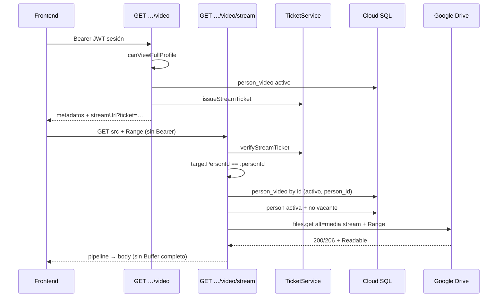

# Arquitectura del streaming de videos con HTTP Range (Fase 3C.0)

**Estado:** **ARQUITECTURA_COMPLETA** (2026-08-03)  
**Implementación:** **IMPLEMENTADA_Y_VALIDADA** — [`person-profile-video-streaming.md`](./person-profile-video-streaming.md)  
**Precondiciones:** Fases 3A (metadatos) y 3B (ticket) **IMPLEMENTADAS_Y_VALIDADAS**
**Ticket:** [`person-profile-video-stream-ticket.md`](./person-profile-video-stream-ticket.md)  
**API metadatos:** [`person-profile-video-api.md`](./person-profile-video-api.md)  
**Arquitectura general:** [`person-profile-modules-and-presentation-architecture.md`](./person-profile-modules-and-presentation-architecture.md)

---

## 1. Contexto y auditoría del estado actual

### 1.1 Qué existe

| Capacidad | Estado |
|-----------|--------|
| `GET …/person/:personId/video` | Metadatos + ticket (3A/3B) |
| `OrgChartVideoTicketService` | Emite/verifica JWT HS256 `purpose=person-video-stream` |
| `organigrama.person_video` | 13 filas activas (metadatos; sin binario) |
| OAuth Drive readonly (CV) | Token en disco; inventarios video/CV lo reutilizan |
| `GET …/video/stream` | **No existe** |

### 1.2 Hallazgos de auditoría (solo lectura)

| Pieza | Hallazgo | Acción de diseño |
|-------|----------|------------------|
| `downloadCvPdfBuffer` (`google-drive-cv-client.ts`) | `alt=media` + `responseType: 'arraybuffer'` → **Buffer completo**; sin Range | **No reutilizar** para video |
| Inventario video | Reusa `createDriveCvClient` / OAuth CV | Reutilizar **solo auth/cliente base** |
| Fotos (`org-chart-photo.controller`) | Buffer + `res.send`; JWT sesión en `?access_token=` | **No copiar** patrón Buffer ni JWT de sesión en query |
| Streams Nest/Express | No hay `pipeline` / abort de media en `src/` | Diseñar desde cero con `stream.pipeline` |
| Timeouts media | Inexistentes | Definir timeout de **apertura** upstream |
| Ticket 3B | Stateless; sin BD en verify | Revalidar fila `person_video` + persona en cada request de stream |

### 1.3 Piezas reutilizables vs separadas

**Reutilizar**

- `createDriveCvClient` / carga OAuth `drive.readonly` (misma credencial si tiene acceso a la carpeta de videos).
- `OrgChartVideoTicketService.verifyStreamTicket`.
- Política de emisión ya aplicada vía `canViewFullProfile` (TTL corto).
- Helpers de vacante (`isVacancyPerson`).

**Mantener separado**

- Cliente Nest de **stream media** (nuevo módulo bajo `src/org-chart/video/`), no scripts CLI de CV.
- No compartir `downloadCvPdfBuffer` ni validaciones PDF.
- No usar el patrón de fotos (Buffer + cache público de bytes).
- Folder ID de video ya separado (`GOOGLE_DRIVE_VIDEO_FOLDER_ID`); el stream usa `drive_file_id` de BD, no el folder en cada request.

**Riesgo de acoplar al cliente CV:** mutaciones futuras (límites PDF, arraybuffer) romperían el proxy; blast radius del token OAuth compartido. Mitigación: wrapper fino `openDriveMediaStream({ fileId, range, signal, timeout })` en el módulo video, que solo llama a `files.get` con `responseType: 'stream'`.

**googleapis / Range:** el stack actual (`googleapis` + gaxios) admite `headers: { Range }` y `responseType: 'stream'`; expone `status`, `headers` (`content-range`, `content-length`, `content-type`) y `data` como `Readable`. **No está implementado** en este repo; hay que validar smoke en 3C con un MP4 real (Shared Drives / `supportsAllDrives: true`).

---

## 2. Flujo completo (secuencia)



---

## 3. Contrato del endpoint stream

```http
GET /api/org-chart/person/:personId/video/stream?ticket=<jwt-media>
```

### 3.1 Credencial (decisión cerrada)

| Pregunta | Decisión |
|----------|----------|
| ¿Ticket como única credencial? | **Sí** |
| ¿Exigir Bearer de sesión? | **No** (`<video src>` no lo envía) |
| ¿JWT principal en query? | **Prohibido** |
| ¿Bearer sin ticket? | **Prohibido** |

El endpoint debe marcarse como **público respecto al `JwtAuthGuard`** (p. ej. `@Public()` / exclusiones existentes del proyecto) **solo** para no exigir sesión; la autorización real es el ticket. No confundir “sin Bearer” con “sin auth”.

Query obligatoria: `ticket`. Ausente → **401**.

---

## 4. Autorización y revalidación

### 4.1 Pasos obligatorios por request (antes de abrir Drive)

1. Existe `ticket` no vacío.
2. `verifyStreamTicket`: firma HS256, exp, purpose, versión, claims.
3. `payload.targetPersonId === :personId` (URL).
4. SELECT `person_video` WHERE `id = personVideoId` (LIMIT 1).
5. Fila existe, `is_active = true`, `person_id = targetPersonId`, `drive_file_id` presente, mime compatible (`video/mp4` o whitelist).
6. Persona target existe, `is_active`, **no vacante** (`isVacancyPerson`).
7. Abrir stream Drive con Range opcional.

### 4.2 ¿Revalidar `canViewFullProfile` en cada Range?

| Opción | Pros | Contras |
|--------|------|---------|
| A. Confiar 120 s en emisión | Barato | Ventana de revocación |
| B. CTE jerárquico por Range | Máxima frescura | Costoso (muchos Ranges) |
| **C. Híbrida (recomendada)** | Defensa en profundidad sin CTE | Revocación de permiso ≤ TTL |

**Recomendación: C (híbrida)**

- **Confiar** en la autorización jerárquica evaluada al **emitir** el ticket durante el TTL.
- **Revalidar en cada request:** video activo, pertenencia video↔target, persona activa, no vacante, `drive_file_id`.
- **No** ejecutar `canViewFullProfile` / CTE visual por cada Range.
- TTL corto (120 s, ajustable) limita la ventana si se revoca permiso.

**Riesgo residual:** un viewer pierde permiso y sigue streameando hasta `exp`. Compensación: TTL corto; ops puede rotar `PERSON_VIDEO_STREAM_TICKET_SECRET` (invalida todos los tickets).

---

## 5. Ticket y múltiples Ranges

- Un mismo ticket **puede** autorizar N requests Range mientras `now < exp`.
- Validar expiración **al inicio** de cada request HTTP.
- Si el ticket **expira durante** un body ya autorizado: **no** cortar la conexión a mitad (evitar UX rotos); nuevas requests → **401** `STREAM_TICKET_EXPIRED`.
- Pausa + seek tras TTL: el navegador falla; el frontend pide de nuevo metadatos/ticket (ver §14).

Detalle del ticket: [`person-profile-video-stream-ticket.md`](./person-profile-video-stream-ticket.md).

---

## 6. Contrato final de metadatos (propuesto para 3C — pendiente de implementar)

Eliminar flags redundantes `streamReady` y `ticketReady`.

```json
{
  "hasVideo": true,
  "fileName": "Video de presentación",
  "mimeType": "video/mp4",
  "sizeBytes": 123456,
  "lastSync": "2026-08-03T20:34:00.898Z",
  "streamTicket": "<jwt>",
  "streamTicketExpiresAt": "2026-08-03T20:36:00.898Z",
  "streamUrl": "/api/org-chart/person/1077/video/stream?ticket=<jwt>"
}
```

Negativo sin cambio:

```json
{ "hasVideo": false }
```

| Campo | Notas |
|-------|--------|
| `streamUrl` | Path relativo API (mismo origin / proxy); ticket en query |
| `streamTicket` | Opcional duplicar si el FE quiere renovar sin parsear URL; preferencia: incluir ambos por claridad |
| Sin `videoId` público | Solo dentro del JWT |
| Sin Drive ids | — |

**TTL:** mantener default **120 s** en MVP; si seek/pausa falla en pruebas UX, subir a **300 s** vía env (máx. 600) sin cambiar claims.

---

## 7. Acceso a Google Drive

### 7.1 Cliente conceptual

```ts
openDriveMediaStream({
  driveFileId: string;      // solo servidor
  rangeHeader?: string;     // "bytes=…" ya validado o crudo reenviado
  signal: AbortSignal;
  timeoutMs: number;        // solo apertura / headers
}): Promise<{
  status: number;
  headers: Record<string, string>;
  body: NodeJS.ReadableStream;
}>
```

Llamada:

```
drive.files.get(
  { fileId, alt: 'media', supportsAllDrives: true },
  { responseType: 'stream', headers: range ? { Range: range } : {}, signal/timeout según cliente HTTP }
)
```

### 7.2 Políticas

- Misma credencial OAuth readonly de CV **si** tiene acceso a los files; config de folder separada (ya existe).
- No hacer archivos públicos; no exponer `drive_file_id` al FE.
- **No** Buffer completo; **no** disco temporal; **no** bytes en PostgreSQL.
- Errores Drive tipados internamente (`STREAM_DRIVE_*`); mensajes al cliente genéricos.

---

## 8. HTTP Range

### 8.1 Decisiones

| Tema | Decisión |
|------|----------|
| Sin Range | **200** + `Accept-Ranges: bytes` |
| Con Range válido | **206** + `Content-Range` |
| Multi-range (`bytes=0-1,2-3`) | **Rechazar** → **416** |
| Parseo | Validar con tamaño confiable cuando exista; reenviar Range a Drive |
| Inventar Content-Length | **No**, si no es seguro |

### 8.2 Casos

| Caso | Comportamiento |
|------|----------------|
| Sin `Range` | 200; body completo vía pipe; `Content-Length` si conocido |
| `bytes=0-` / `bytes=0-999` / `bytes=1000-` / sufijo | Un rango; 206 si Drive/BD lo permiten |
| Fuera de tamaño / inválido | **416** + `Content-Range: bytes */<total>` si total conocido |
| Multi-range | **416** |
| Drive responde distinto a lo esperado | Preferir **headers/status de Drive** si coherentes; si 416/4xx Drive → mapear; si 200 con Range pedido → aceptar si body ok; log warning |

### 8.3 Fuente del tamaño (orden de confianza)

1. Headers de respuesta Drive (`Content-Range` total / `Content-Length`).
2. `person_video.drive_file_size`.
3. Ausencia → no inventar `Content-Length`; Range estricto puede degradarse (preferir reenviar a Drive y confiar en su 206/416).

Si BD ≠ Drive: **continuar** con headers Drive; **warning** interno; **no** actualizar BD en el path de stream (job de sync aparte).  
Si `drive_file_size` NULL: reenviar Range a Drive; validación local mínima (sintaxis / multi-range).

---

## 9. Headers de respuesta (cliente)

### 9.1 Comunes

- `Content-Type`: `mime_type` BD o Drive (`video/mp4`).
- `Accept-Ranges: bytes`
- `Cache-Control: private, no-store` (ticket en URL)
- `X-Content-Type-Options: nosniff`
- `Content-Disposition: inline`
- **No** reenviar ETag de Drive al cliente (reduce fingerprinting / complejidad con auth).
- **No** `Last-Modified` de Drive en MVP.

### 9.2 200 (sin Range)

- `Content-Length` si conocido de forma segura.

### 9.3 206 (con Range)

- `Content-Range: bytes start-end/total`
- `Content-Length` del segmento.

### 9.4 HEAD

**No soportar HEAD en MVP.** `<video>` no lo requiere; añade superficie sin beneficio claro. Reevaluar solo si diagnóstico ops lo exige.

### 9.5 CORS

Igual que el resto de la API (origins ya configurados). El media suele ser same-origin vía proxy Vite/API.

---

## 10. Matriz de errores HTTP

| Situación | HTTP | Código interno | Nota anti-enumeración |
|-----------|------|----------------|------------------------|
| Ticket ausente / firma / purpose / claims | **401** | `STREAM_TICKET_INVALID` | Mensaje genérico |
| Ticket expirado | **401** | `STREAM_TICKET_EXPIRED` | Distinguible para FE (body `code` estable, sin secretos) |
| Target URL ≠ ticket | **404** | `STREAM_TARGET_MISMATCH` | No revelar detalle |
| Video inexistente / inactivo / otra persona | **404** | `STREAM_VIDEO_NOT_FOUND` | Misma forma |
| Target inexistente / inactivo / vacante | **404** | `STREAM_VIDEO_NOT_FOUND` | Misma forma |
| `drive_file_id` ausente | **404** | `STREAM_VIDEO_NOT_FOUND` | — |
| Archivo eliminado Drive (404) | **404** | `STREAM_DRIVE_NOT_FOUND` | Sin ids Drive |
| Range inválido / multi / no satisfacible | **416** | `STREAM_RANGE_INVALID` | `Content-Range: bytes */N` si N conocido |
| Drive 403 | **502** | `STREAM_DRIVE_FORBIDDEN` | Credencial/ACL |
| Timeout apertura / cuota / 5xx Drive | **503** | `STREAM_DRIVE_TIMEOUT` / etc. | Reintentable |
| Error pipe inesperado (antes de body) | **500** | `STREAM_PIPE_ERROR` | Sin stack al cliente |
| Cliente aborta / seek cancela | — | `STREAM_CLIENT_ABORTED` | No 5xx si ya había status |

Formato: Nest estándar (`statusCode`, `message`, opcional `code` interno estable para expiración). **No** filtrar mensajes de Google ni SQL.

---

## 11. Pipeline, backpressure y abort

```
Drive Readable  →  stream.pipeline(…)  →  Express res
```

**Preferencia:** `node:stream/promises` `pipeline` (backpressure + cleanup).

| Evento | Acción |
|--------|--------|
| Cliente `close` / abort | AbortController → destroy upstream Drive |
| Seek del browser | Cancela request previa → `STREAM_CLIENT_ABORTED` (esperado) |
| Error red Drive mid-stream | Log error; no reescribir headers si ya flushed |
| Fin normal | pipeline resolve; log bytes/duración si disponibles |

- No retener archivo en memoria.
- No `res.send(Buffer)`.
- No lanzar filtro HTTP Nest después de iniciar body.
- Diferenciar cierre normal / abort cliente / error servidor en logs.

---

## 12. Timeouts y límites (conceptuales — no agregar env aún)

| Variable futura | Propuesta MVP |
|-----------------|---------------|
| `PERSON_VIDEO_STREAM_UPSTREAM_TIMEOUT_MS` | **20000** (solo hasta headers/inicio de body) |
| Duración máxima del pipe | **Ninguna** (seek/largo) |
| `PERSON_VIDEO_STREAM_MAX_SIZE_BYTES` | Confiar en inventario/planner; opcional check vs `drive_file_size` antes de abrir |
| Semáforo por instancia | **No** en MVP; Cloud Run concurrency + cuotas Drive; métricas primero |

Si en el futuro un archivo supera máximo: **404/413** genérico en stream y exclusión en sync — fuera de 3C.0.

---

## 13. Logging seguro

**Permitido:** `requestId`, `personVideoId`, `targetPersonId`, `viewerPersonId` (ids internos), status final, Range normalizado, bytes pedidos/transmitidos si se conocen, duración, código interno, upstream status, flag abort.

**Prohibido:** ticket, query completa, JWT sesión, `drive_file_id`, documento, nombre, correo, URL Drive, OAuth, Authorization.

Códigos internos: ver §10.

---

## 14. Contrato con frontend (futuro — no implementar)

1. `GET /person/:id/video` (Bearer) → metadatos + `streamUrl`.
2. `<video src={streamUrl} controls preload="metadata" playsInline />`.
3. El navegador emite Ranges.
4. **401 por expiración:** el elemento `<video>` **no** expone status HTTP de forma fiable; usar evento `error`, limitar reintentos (p. ej. máx. 2), volver a pedir metadatos, reemplazar `src`, intentar restaurar `currentTime`.
5. Renovación: al abrir Presentación; ante error; al reentrar al módulo. **No** polling continuo del ticket.
6. Si 120 s es corto en UX real → subir TTL por env tras medición.

---

## 15. Estrategia de pruebas (diseño — no ejecutar aún)

### Unitarias

Ticket válido/expirado/inválido; target mismatch; video inactivo/otra persona; vacante; Range ausente/válido/abierto/inválido/multi; 200/206 headers; 416; Drive 404/403/timeout; cliente abort; pipeline error; sin leak de secretos/Drive ids.

### Integración

Cliente Drive **mock** (Readable + status/headers).

### Manual / controlada (video pequeño)

GET sin Range; `bytes=0-1023`; `bytes=1024-2047`; seek en browser; ticket expirado; fileId inexistente; cancelación.

---

## 16. Decisiones cerradas

| # | Pregunta | Decisión |
|---|----------|----------|
| 1 | ¿Ticket como única credencial? | **Sí** |
| 2 | ¿Revalidar jerarquía por Range? | **No** (híbrida: estado video/persona sí) |
| 3 | ¿TTL 120 s adecuado? | **Sí en MVP**; ajustar env si UX lo exige |
| 4 | ¿200 sin Range / 206 con Range? | **Sí** |
| 5 | ¿Multi-range? | **No** → 416 |
| 6 | ¿Validar tamaño? | Drive > BD > ausente; no inventar Length |
| 7 | ¿Expira durante reproducción? | No cortar body en curso; nuevas req 401 |
| 8 | ¿pipeline + AbortController? | **Sí** |
| 9 | ¿HEAD? | **No** en MVP |
| 10 | ¿Cache-Control? | `private, no-store` |
| 11 | ¿`streamReady` / `ticketReady`? | **Eliminar** en contrato 3C; usar `streamUrl` |
| 12 | ¿HTTP codes? | 401 ticket; 404 estado/recurso; 416 Range; 502/503 Drive; 500 raro |
| 13 | ¿Timeouts? | ~20 s apertura upstream; sin tope de pipe |
| 14 | ¿Logs? | Ids internos + Range + status; nunca ticket/Drive id |
| 15 | ¿Cliente Drive? | Auth OAuth CV reutilizable; **nueva** función stream (no Buffer CV) |

---

## 17. Riesgos pendientes

| Riesgo | Mitigación |
|--------|------------|
| Shared Drives / Range edge cases | Smoke 3C con MP4 real |
| Token OAuth en disco en Cloud Run | Secret Manager; rotación; least privilege |
| Videos grandes (~200 MB observados) | Stream only; monitorear egress/timeouts Cloud Run |
| FE no ve 401 de `<video>` | Renovación por `error` + límite de reintentos |
| Revocación de permiso ≤ TTL | TTL corto; rotación de secreto de ticket |
| Diferencia size BD vs Drive | Warning; headers Drive; sync job aparte |
| Cuotas Drive bajo seek agresivo | Métricas antes de semáforo |

---

## 18. Plan de implementación — Fase 3C

Orden exacto sugerido (código en fase posterior):

1. **Contrato metadatos:** añadir `streamUrl`; quitar `streamReady` / `ticketReady`; actualizar tipos + tests 3A/3B.
2. **Cliente Drive stream:** `openDriveMediaStream` (Nest), tests con mock; **no** usar `downloadCvPdfBuffer`.
3. **Parser Range:** un rango; multi → 416; tests unitarios.
4. **`OrgChartVideoStreamService`:** verify ticket → DB → vacante → Drive → headers.
5. **Controller** `GET …/video/stream` + exclusión JwtAuthGuard + `@Query('ticket')`.
6. **Pipeline + AbortController** + logs seguros.
7. **Timeout apertura** (env documentada en `.env.example` cuando se implemente).
8. **Tests unitarios** (§15) + integración mock.
9. **Validación real controlada** (SELECT-only BD; stream de un MP4 pequeño; sin mutar `person_video`).
10. **Docs:** marcar Fase 3C **IMPLEMENTADA_Y_VALIDADA** solo tras smoke Range.
11. **Frontend:** fase posterior (pestaña Presentación); fuera de 3C backend mínimo.

**Fuera de alcance 3C:** HEAD, ETag, semáforo, UPDATE de size en path stream, MC1, CV, UI visible.

---

## 19. Estructura de código propuesta (no crear aún)

```
src/org-chart/video/
  org-chart-video-stream.service.ts
  org-chart-video-stream.types.ts
  org-chart-video-range.ts
  org-chart-video-drive-media.client.ts
  org-chart-video-stream.service.spec.ts
  org-chart-video-range.spec.ts
```

Registro en `OrgChartModule`; ruta en `OrgChartController` (o controller video dedicado si crece).

---

## 20. Estado

**Fase 3C.0 — ARQUITECTURA_COMPLETA**  
**Fase 3C — IMPLEMENTADA_Y_VALIDADA** (ver [`person-profile-video-streaming.md`](./person-profile-video-streaming.md))

### Desviaciones menores vs diseño 3C.0

- End past EOF se **recorta** al último byte (en lugar de 416 inmediato) cuando el tamaño BD es conocido.
- GET sin Range en smoke se abortó tras ~2KB (no se descargó el MP4 completo a disco).
