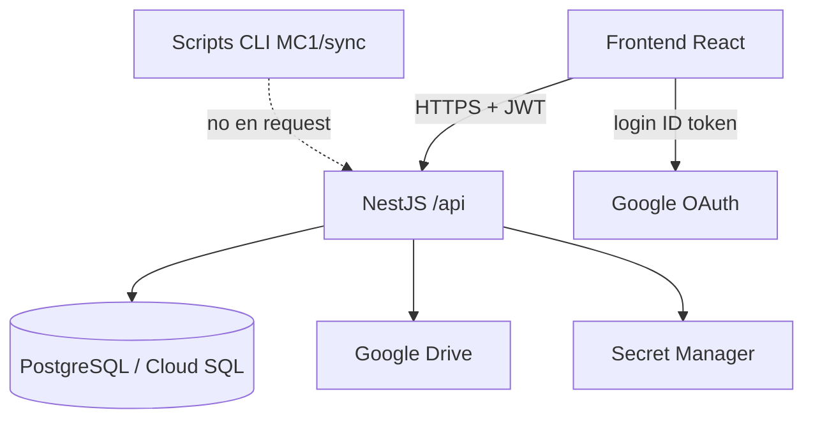
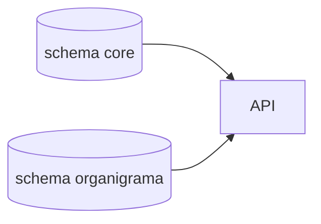

# Arquitectura (Backend)

> Responsabilidades del API NestJS y límites de lo que corre en HTTP vs CLI.

[← Anterior](./README.md) · [Índice](./README.md) · [Siguiente →](./02-entorno-local.md)

## Contexto

UI y rutas: [documentación Frontend](https://github.com/DesarrolloFabrica/Organigrama_Frontend/blob/main/documentacion/01-arquitectura.md).

Organigrama **no** es RRHH: lee Core y escribe poco (perfil OP, relaciones visuales, metadatos CV/video, evaluaciones MC1).

## Módulos Nest (`src/app.module.ts`)

Prefijo global: `/api` (`main.ts`).

| Módulo | Responsabilidad |
|--------|-----------------|
| `AuthModule` | Google → JWT, `dev-login`, `GET /auth/me`. Guard JWT global |
| `ProfileModule` | `GET/PATCH /profile/me` |
| `OrgChartModule` | Árbol, ficha, CV, video, competencies, people-search, fotos, versiones |
| `HealthModule` | Salud |
| `GoogleWorkspaceModule` | Fotos Directory (diagnóstico) |
| `CvSkills*` / `CvEvidence` / `CvAttributes` | Pipeline CV; **sin** controllers de producto |
| `McCatalogModule` | Catálogo + motor **PA2** |
| `McPipelineModule` | **Solo** P0: `McCvSnapshotService` |
| `Mc1ProfilePreviewModule` | `GET /dev/mc1-profile-preview` (lab) |

P1–P4 / R1 / Profile viven en `src/mc-pipeline/` y se ejecutan por **CLI**. Ver [07-competencias-mc1.md](./07-competencias-mc1.md).

## Datos

Detalle: [03-base-de-datos.md](./03-base-de-datos.md).

## Clasificación

| Estado | Ejemplos |
|--------|----------|
| **PRODUCTIVO (HTTP)** | Auth, organigrama lazy, ficha, CV, video+ticket, competencies, people-search, health |
| **PRODUCTIVO (CLI)** | `sync:drive-*`, extract/enrich/evaluate, `mc:p2-*` … `mc:profile-*` |
| **LEGACY** | `GET /api/org-chart`, `/team/:id` (410 si legacy off); PA2 fallback ficha |
| **EXPERIMENTAL** | `src/mc-pipeline/experimental/deterministic-resolver/` |
| **NO IMPLEMENTADO** | `McProfilePublisher`; tabla `mc_pipeline_run` |

## Código

- `src/app.module.ts`, `src/main.ts`
- `src/org-chart/org-chart.controller.ts`
- `src/org-chart/org-chart-tree.engine.ts`
- `src/mc-pipeline/person-profile/`

[← Anterior](./README.md) · [Índice](./README.md) · [Siguiente →](./02-entorno-local.md)
