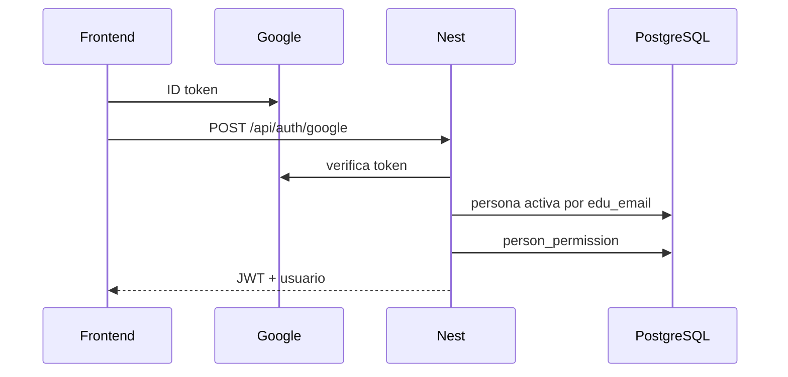

# Autenticación y permisos (Backend)

> Fuente de verdad de seguridad: JWT, guards y matriz de autorización.

[← Anterior](./03-base-de-datos.md) · [Índice](./README.md) · [Siguiente →](./05-organigrama-api.md)

UI y visibilidad de controles: [Frontend — autenticación y visibilidad](https://github.com/DesarrolloFabrica/Organigrama_Frontend/blob/main/documentacion/03-autenticacion-y-visibilidad.md). El Frontend **no** es autoridad de seguridad.

## AUTHENTICATION vs AUTHORIZATION

| | Qué responde | Dónde |
|--|--------------|--------|
| **Authentication** | ¿Quién eres? | Google ID token → `core.person` → JWT |
| **Authorization** | ¿Qué datos te muestro? | Jerarquía visual + `ORG_READ_ALL` / excepciones |

Un JWT válido **no** implica ficha completa de cualquiera.

## Autenticación

- `POST /api/auth/google` y `POST /api/auth/dev-login` son `@Public`.
- Dominio: `@cun.edu.co`. Convención de local-part (guion bajo) salvo `ORG_TECHNICAL_EMAILS`.
- Guard global: `JwtAuthGuard`. Header `Authorization: Bearer`, o en GET de fotos `?access_token=`.
- `GET /api/auth/me` exige JWT.
- **No** hay cookies de sesión ni refresh token.
- Dev-login: solo `NODE_ENV=development` **y** `DEV_LOGIN_ENABLED=true`. Si no → **404**.

Código: `src/auth/`.

Tras cambiar `core.person_permission`, el usuario debe **volver a iniciar sesión** (permisos en el JWT).

## Permisos técnicos

Tabla `core.person_permission`:

| Código | Efecto |
|--------|--------|
| `ORG_READ_ALL` | Visibilidad total **sin** redacción jerárquica (`viewerHasGlobalReadAccess`) |
| `ORG_ADMIN` | Administración técnica. El grant de arranque suele asignar **ambos** |

`ORG_ADMIN_EMAILS`: si el correo está en la lista y no hay filas en BD, el JWT incluye `ORG_READ_ALL` y `ORG_ADMIN`.

**No** insertar usuarios técnicos en `org_visual_relation` solo para “darles acceso”.

Script: `npm run org:grant-admin -- <correo@cun.edu.co>`.

El selector de **versiones** del organigrama usa allowlist `ORG_CHART_VERSION_ADMIN_EMAILS` (API) y su espejo en FE `VITE_ORG_CHART_VERSION_ADMIN_EMAILS` — **no** es `ORG_ADMIN` del JWT.

## Autorización jerárquica

Grafo: `organigrama.org_visual_relation` (no `core.hierarchy.level`).

`OrgChartVisibilityService.canViewFullProfile`:

| Viewer respecto al target | Ficha completa |
|---------------------------|----------------|
| Misma persona (self) | Sí |
| Target es descendiente visual | Sí |
| `ORG_READ_ALL` | Sí (todo) |
| Jefe, par, otra rama | No → vista pública mínima |

Vista mínima: identidad institucional, foto, `profile: null`. Sin documento, teléfonos, emergencia, CV.

CV (`GET …/cv`): misma política. Sin permiso → `{ hasCv: false }` **sin** revelar si el archivo existe (anti-enumeración).

Competencias de ficha: `assertCanView` / `canViewFullProfile`. Sin permiso → **403**.

People-search: universo = descendientes (+ self) salvo `ORG_READ_ALL`.

## Matriz de acceso

| Recurso | Self | Descendiente visual | `ORG_READ_ALL` | Otro autenticado |
|---------|:----:|:-------------------:|:--------------:|:----------------:|
| Perfil completo (PII) | Sí | Sí | Sí | No → vista mínima |
| CV | Sí | Sí | Sí | No → `{ hasCv: false }` |
| Competencias (ficha) | Sí | Sí | Sí | No → 403 |
| Video metadatos | Sí | Sí | Sí | **Sí** |
| Video stream | Ticket | Ticket | Ticket | Ticket (emitido tras metadatos JWT) |

`ORG_ADMIN` **solo** no abre ficha completa de todos: el cortocircuito global es `ORG_READ_ALL`.

## Excepciones

### Presentación (video)

Cualquier autenticado puede pedir `GET …/person/:id/video` (no usa `canViewFullProfile`). Vacantes → `hasVideo: false`.

### Stream (`@Public` + ticket)

`GET /api/org-chart/person/:personId/video/stream?ticket=…` es `@Public` porque `<video src>` no envía el JWT de sesión de forma fiable.

**No es acceso anónimo irrestricto:** el `ticket` es un JWT distinto, firmado con `PERSON_VIDEO_STREAM_TICKET_SECRET`, de vida corta. Sin ticket válido → error. Emitir el ticket **sí** exige sesión. Detalle: [06-perfiles-cv-y-video.md](./06-perfiles-cv-y-video.md).

### Health y login

Públicos a propósito.

### Preview MC1 lab

`GET /dev/mc1-profile-preview` (lab) — no es producto; la ruta FE no pasa por `RequireAuth`.

## Qué no afirmar

- “No hay RBAC” — **falso** (`ORG_READ_ALL` / `ORG_ADMIN`).
- “Todo endpoint usa JWT de sesión” — **falso** (stream usa ticket).
- “ORG_ADMIN solo basta para ver todo” — el cortocircuito mira **`ORG_READ_ALL`**.

Código: `src/permissions/`, `src/org-chart/org-chart-visibility.service.ts`.

[← Anterior](./03-base-de-datos.md) · [Índice](./README.md) · [Siguiente →](./05-organigrama-api.md)
