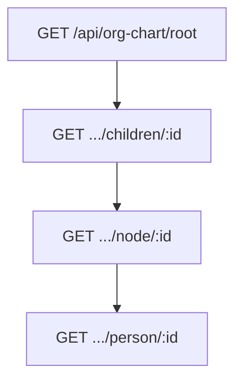

# Organigrama API

> Endpoints lazy, versiones, construcción del árbol y legacy.

[← Anterior](./04-autenticacion-y-permisos.md) · [Índice](./README.md) · [Siguiente →](./06-perfiles-cv-y-video.md)

Mapa UI / lazy loading: [Frontend — organigrama](https://github.com/DesarrolloFabrica/Organigrama_Frontend/blob/main/documentacion/04-organigrama.md).

## Idea central

| Concepto | Qué es | ¿Pinta el mapa? |
|----------|--------|:---------------:|
| **Core hierarchy** (`core.hierarchy`) | Catálogo laboral | **No** |
| **Visual hierarchy** (`organigrama.org_visual_relation`) | Padre → hijo OP | **Sí** |

El cliente debe pedir la **raíz**, luego **hijos** al expandir. No uses endpoints del árbol entero (legacy).

## API principal (JWT)

Base: `/api/org-chart`.

| Método | Ruta | Uso |
|--------|------|-----|
| GET | `/root` | Carga inicial |
| GET | `/node/:id` | Nodo para explorar |
| GET | `/children/:id` | Hijos directos |
| GET | `/person/:id` | Ficha (redactada) |
| GET | `/summary/:personId` | Resumen jerárquico |
| GET | `/search?q=` | Buscar personas |
| GET | `/vacancies` | Vacantes |
| GET | `/photos/:personId` | Proxy de foto |

Versiones (`OrgChartVersionController`):

| Método | Ruta |
|--------|------|
| GET | `/api/org-chart/versions` |
| GET | `/api/org-chart/versions/compare?baseVersionId=&targetVersionId=` |
| POST | `/api/org-chart/versions/snapshot` |

Query `versionId` / `versionCode` en rutas de árbol. Allowlist: `ORG_CHART_VERSION_ADMIN_EMAILS`.

## LEGACY — no usar

| Ruta | Si `ORG_CHART_LEGACY_ENABLED=false` |
|------|-------------------------------------|
| `GET /api/org-chart` | **410 Gone** |
| `GET /api/org-chart/team/:id` | **410 Gone** |

Sin JWT → **401**. En Cloud Run la variable debe ser `false`. Ausente/vacía → legacy **habilitado** (solo aceptable en local).

## Construcción del árbol

Prioridad (`src/org-chart/org-chart-tree.engine.ts`):

1. Hijos en `org_visual_relation` (activos, versión).
2. Si no hay, fallback `org-chart.visual-map.ts`.

Overrides y versiones permiten un mapa distinto del “oficial” sin mutar Core.

Vacantes: nodos sin persona real; **sin** Presentación ni competencias de ficha.

Eventos de fuerza laboral: `GET …/person/:id/workforce-events`.

## Permisos en el mapa

Navegar nodos ≠ ver ficha completa. El JSON de nodos se **redacta** por viewer. Búsqueda puede encontrar gente fuera de la rama; hits sin permiso van sin PII extendida.

Reglas: [04-autenticacion-y-permisos.md](./04-autenticacion-y-permisos.md).

## Fotos

`GET /api/org-chart/photos/:personId?access_token=` para ``. Resolución: sesión Google, persistidas, Directory (si habilitado).

Código: `src/org-chart/org-chart.controller.ts`, `org-chart-tree.engine.ts`.

[← Anterior](./04-autenticacion-y-permisos.md) · [Índice](./README.md) · [Siguiente →](./06-perfiles-cv-y-video.md)
