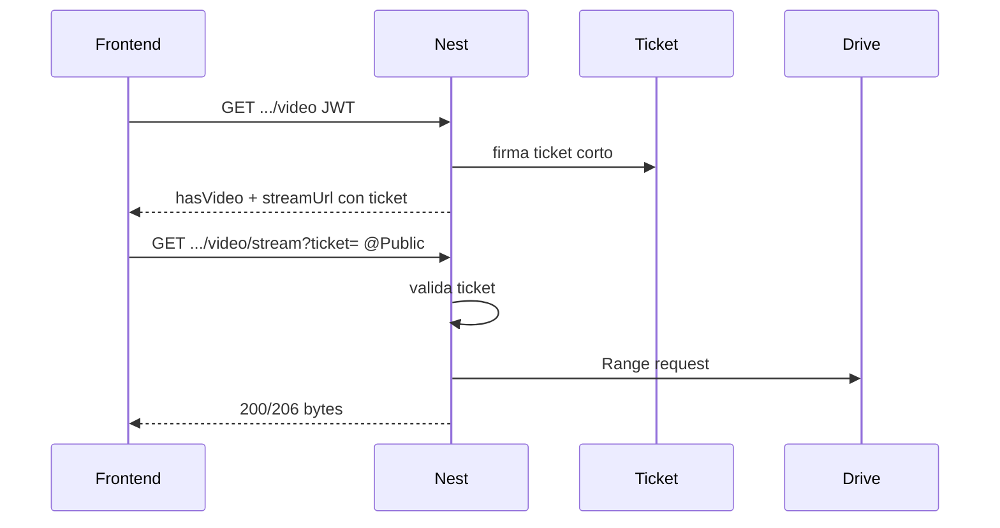

# Perfiles, CV y video (Backend)

> Endpoints, Drive, tickets de stream y seguridad de ficha.

[← Anterior](./05-organigrama-api.md) · [Índice](./README.md) · [Siguiente →](./07-competencias-mc1.md)

Renderizado UI: [Frontend — perfiles, CV y video](https://github.com/DesarrolloFabrica/Organigrama_Frontend/blob/main/documentacion/05-perfiles-cv-y-video.md).

## Flujo al abrir una persona

```text
GET …/person/:id  (JWT)
      ↓
OrgChartVisibilityService → Full profile o Limited
      ↓
CV / video / competencies según matriz de [04](./04-autenticacion-y-permisos.md)
```

Onboarding propio: `GET/PATCH /api/profile/me` (documento, teléfono, emergencia) — independiente del panel de terceros.

## Visibilidad (resumen)

| Recurso | Política |
|---------|----------|
| Ficha completa | Self / descendientes / `ORG_READ_ALL` |
| CV | Igual que ficha completa; denegación = `{ hasCv: false }` |
| Competencias | Igual que ficha completa (403 si no) |
| Presentación metadatos | Cualquier autenticado |
| Stream | Ticket, no JWT de sesión |

## CV

- Origen: carpeta Drive de CVs. Asociación **solo** por número de documento al inicio del filename.
- Persistencia: `organigrama.person_cv`.
- API: `GET /api/org-chart/person/:personId/cv` (JWT + visibilidad de ficha).
- La API **no** llama a Drive en caliente. Sync: `npm run sync:drive-cv`.
- Extracción Gemini = **CLI** (`extract:cv-skills`, enrich, evidence). No corre al abrir la ficha.

## Video de presentación

Objetivo: stream interno con `Range`. Sin autoplay, sin `webViewLink` ni iframe Drive.



### Metadatos

`GET /api/org-chart/person/:personId/video` — JWT. Emite ticket. No lee bytes de Drive.

### Ticket

- Secreto: `PERSON_VIDEO_STREAM_TICKET_SECRET` (HS256, ≠ `AUTH_JWT_SECRET`).
- TTL corto (default 120 s, rango 30–600 vía `PERSON_VIDEO_STREAM_TICKET_TTL_SECONDS`).
- Razón: `<video src>` no lleva el Bearer de la SPA.

### Stream — `@Public` no es “abierto”

`GET /api/org-chart/person/:personId/video/stream?ticket=`

Nest marca `@Public` para saltar el JWT de sesión. La autorización efectiva es **validar el ticket**. Un ticket filtrado caduca pronto. Soporta `Range` → `206`.

Código: `src/org-chart/video/`. Ops: [docs/person-profile-video-stream-ticket.md](../docs/person-profile-video-stream-ticket.md), [docs/person-profile-video-streaming-architecture.md](../docs/person-profile-video-streaming-architecture.md).

### Sync Drive video

`diag:drive-video`, `plan:drive-video`, `sync:drive-video`. Match por documento. Credencial OAuth readonly compartida (`GOOGLE_DRIVE_CV_TOKEN_PATH`). En Cloud Run: Secret Manager `organigrama-google-drive-oauth-token`.

Runtime: `person_video.drive_file_id` (mig. `025`); **no** necesita Folder ID. Vacantes: nunca Presentación.

[← Anterior](./05-organigrama-api.md) · [Índice](./README.md) · [Siguiente →](./07-competencias-mc1.md)
