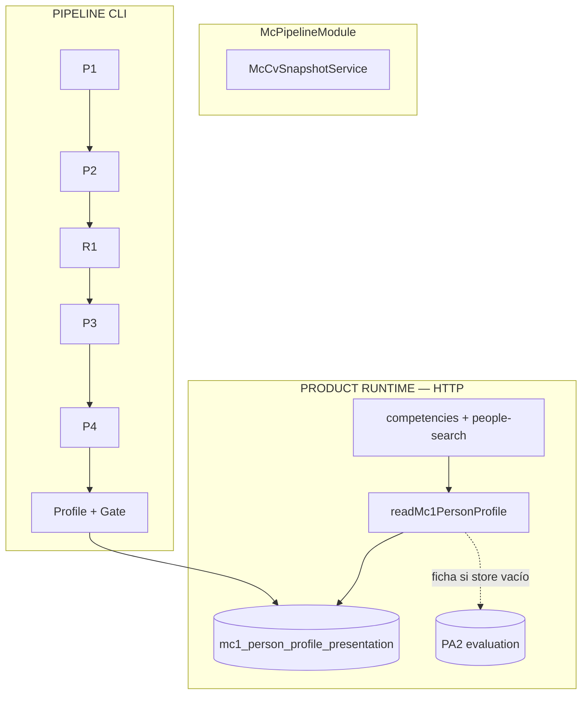

# Competencias MC1 (Backend)

> Store, Reader, pipeline CLI, PA2 legado y experimental.

[← Anterior](./06-perfiles-cv-y-video.md) · [Índice](./README.md) · [Siguiente →](./08-buscador-competencias-api.md)

UI (radar, rendering): [Frontend — competencias MC1](https://github.com/DesarrolloFabrica/Organigrama_Frontend/blob/main/documentacion/06-competencias-mc1.md).

## Qué problema resuelve

MC1 representa **práctica profesional demostrada en el CV**, no el cargo de Core. Convierte el CV en un perfil publicable (dominios → especialidades → skills) que ficha y buscador leen **sin** reejecutar el pipeline.

## De CV a producto (diseño)

```text
CV → P0 Snapshot → P1 Evidence → P2 Domain → R1 Field
  → P3 Specialties → P4 Skills → Profile + Publication Gate
  → Store → Reader → API / Frontend
```

En runtime HTTP solo corren **Store + Reader** (+ fallback PA2 en ficha).

## Estado por componente

| Componente | Estado | Ejecución | ¿Producto HTTP? |
|------------|--------|-----------|:--------------:|
| Cloud Store + Reader | **PRODUCT RUNTIME** | Nest en request | Sí |
| P0 `McCvSnapshotService` | **PRODUCTIVO (Nest)** | Módulo + CLI/MDE | Indirecto |
| P1 Evidence | **PIPELINE CLI** | `mc:p1-persistence-*` | No |
| P2 Domain | **PIPELINE CLI** | `mc:p2-functional-pilot-7d` | No |
| R1 Field | **PIPELINE CLI** | `mc:r1-field-resolution-8a` | No |
| P3 Specialties | **PIPELINE CLI** | `mc:p3-specialty-discovery-8b` | No |
| P4 Skills | **PIPELINE CLI** | `mc:p4-skill-discovery-8d` | No |
| Profile + Publication Gate | **PIPELINE CLI** | `mc:profile-pilot-8e` / `8f` | Resultado vía store |
| PA2 | **LEGACY / FALLBACK** | CLI + lectura ficha | Solo si store vacío |
| Resolver determinístico | **EXPERIMENTAL** | fuera de runners | **No** |
| `McProfilePublisher` / `mc_pipeline_run` | **NOT WIRED** | — | No |



## PRODUCT RUNTIME

| Pieza | Comportamiento |
|-------|----------------|
| Store | `organigrama.mc1_person_profile_presentation` (mig. `028`) |
| Reader | Store primero; en prod error de lectura → `INVALID`; sin fila, no-prod puede usar `ARTIFACT_ONLY` |
| Ficha | `GET …/competencies*` + `canViewFullProfile`; luego fallback PA2 |
| Buscador | Solo store (+ persona activa + payload válido) |
| Radar | `evidenceState` / coverage ≠ seniority; WEAK ≠ incompetencia |
| Preview lab | ruta de lab; no producto |

`McPipelineModule` solo exporta P0. Código: `src/org-chart/org-chart-competencies.service.ts`, `src/mc-pipeline/person-profile/`.

## PIPELINE CLI

No hay endpoint HTTP de pipeline. Scripts en `package.json` (`mc:*`).

| Etapa | Rol | Script |
|-------|-----|--------|
| P0 | Snapshot inmutable | servicio Nest + mig. `026` |
| P1 | Evidencia; offsets = autoridad | `mc:p1-persistence-*` |
| P2 | Candidatos de dominio | `mc:p2-functional-pilot-7d` |
| R1 | Field PRIMARY/SECONDARY | `mc:r1-field-resolution-8a` |
| P3 | Especialidades OBSERVED | `mc:p3-specialty-discovery-8b` |
| P4 | Skills observadas | `mc:p4-skill-discovery-8d` |
| Profile | Ensamble + gate → store | `mc:profile-pilot-8e`, `mc:profile-validation-8f` |

Campañas = `campaignId` local; no escriben Cloud. MDE ≠ verdad de producto.

## LEGACY — PA2

No clasifica. Fallback de ficha. Buscador no lo usa. Writers: `mc:evaluate`, curated, etc.

## EXPERIMENTAL / NOT WIRED

- `src/mc-pipeline/experimental/deterministic-resolver/` — no en runners; `MC1_SHADOW_*` off en Cloud.
- Publisher / `mc_pipeline_run` — **NO IMPLEMENTADO**.
- Banner IA del buscador — UI deshabilitada (lado FE).

## Modelo de perfil

```text
Field / Domain → Specialty → Skills
```

Gate: PRIMARY publicable; SECONDARY sin especialidad observada → `PROVENANCE_ONLY`. Skill observada no desaparece.

## Políticas (resumen)

- Offsets = autoridad de segmentación.
- Evidencia > cargo ([manifiesto](../docs/mc1-manifesto.md)).
- Path `/audio/` ≠ audiovisual; SECOP ≠ specialty LEGAL.
- Versionado de catálogo: [mc1-domain-versioning-policy.md](../docs/mc1-domain-versioning-policy.md).

Decisiones de diseño (ADR-003…010) viven en el repositorio de documentación del producto; no se duplican aquí. Contratos de etapa: carpeta `docs/` del Backend cuando apliquen blueprints / people-search.

[← Anterior](./06-perfiles-cv-y-video.md) · [Índice](./README.md) · [Siguiente →](./08-buscador-competencias-api.md)
