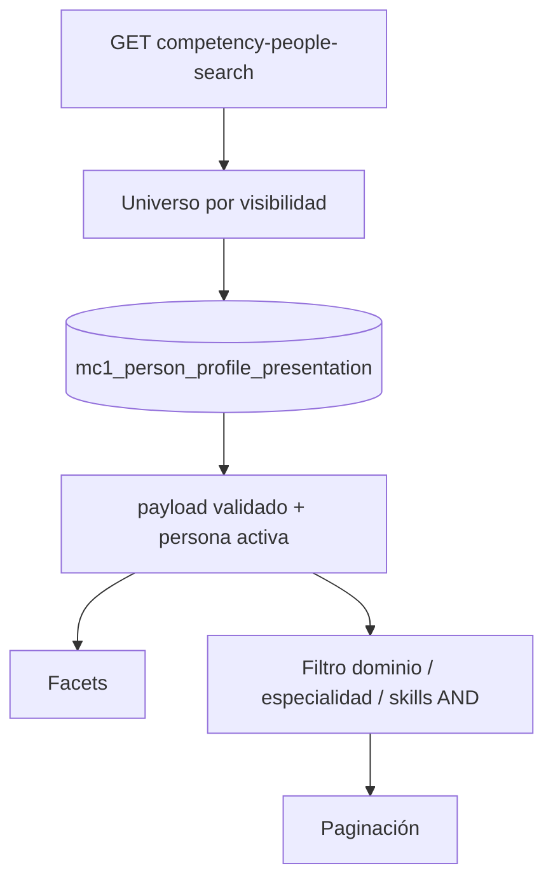

# Buscador de competencias — API

> `GET /api/org-chart/competency-people-search`: store MC1, facets, AND, permisos.

[← Anterior](./07-competencias-mc1.md) · [Índice](./README.md) · [Siguiente →](./09-deploy.md)

UI: [Frontend — buscador](https://github.com/DesarrolloFabrica/Organigrama_Frontend/blob/main/documentacion/07-buscador-competencias.md).

## Estado

| Pieza | Clasificación |
|-------|---------------|
| API people-search | **PRODUCTIVO** |
| Facets dominio → especialidad → skills | **IMPLEMENTED** |
| Skills multi con AND | **IMPLEMENTED** |
| Fuente = store MC1 | **IMPLEMENTED** |
| Banner “IA para proyectos” | **PLANNED** (solo FE disabled) |

## Modelo funcional

```text
Domain / Field  →  Specialty  →  Skills  →  People
```

Un dominio, opcionalmente una especialidad, cero o más skills. Skills con **AND**: la persona debe tener **todas** en esa especialidad.

Sin dominio: solo facets de dominio y conteo del universo autorizado (sin ranking de personas).



## Endpoint

`GET /api/org-chart/competency-people-search`

Query: `domain`, `specialty`, `skills`, `page`, `pageSize`, más `versionId` / `versionCode`.

| Parámetro | Comportamiento |
|-----------|----------------|
| `pageSize` | Default **24**, máximo **50** |
| `skills` | Lista; match **AND** (`.every`) sobre skills de la especialidad |
| Facets | Dominios si no hay dominio; especialidades si hay dominio y no especialidad; skills si hay especialidad |

Respuesta: `authorizedUniverseTotal`, `warnings` (criterios canónicos / obsoletos), `people[]` con `explanation` y `matchedSkills`. Tests exigen **ausencia** de `score` / `confidence`.

Código: `src/org-chart/competency-people-search.service.ts`.

Contrato ampliado: [docs/mc1-competency-people-search-functional-model.md](../docs/mc1-competency-people-search-functional-model.md) (contrastar con este doc si diverge).

## Fuente de datos

**Solo** el store:

- `organigrama.mc1_person_profile_presentation.is_active = TRUE`
- `core.person.is_active = TRUE`
- `validateMc1PresentationPayload` OK; filas inválidas se omiten
- cargo efectivo: override de versión o `core.role`

No ejecuta P0–P4. No lee PA2. Personas solo en PA2 **no aparecen**.

## Permisos

1. JWT obligatorio (401 sin token).
2. Universo = self + descendientes visuales de la versión, salvo `ORG_READ_ALL`.
3. Abrir ficha desde el resultado sigue [04-autenticacion-y-permisos.md](./04-autenticacion-y-permisos.md).

## Vacío / error (contrato)

| Situación | Comportamiento |
|-----------|----------------|
| Sin JWT | 401 |
| Store vacío para el viewer | Universo 0; no inventa gente |
| Criterios obsoletos | `warnings`; no inventa matches |

[← Anterior](./07-competencias-mc1.md) · [Índice](./README.md) · [Siguiente →](./09-deploy.md)
